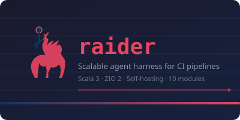

<div align="center">



# Raider

**Scala workflows for coding agents and CI** — Scala 3 + ZIO 2

[](LICENSE)
[](https://www.scala-lang.org/)
[](https://zio.dev/)

</div>

Raider runs a native model/tool loop, a real Scala REPL, and compiled workflows
in a headless CLI. The coding agent can read, search, edit and patch files,
inspect a directory tree, and run commands. Direct OpenAI-compatible and
Anthropic Messages transports are implemented.

The project is under development. The examples below exercise current source;
full SDK packaging and autonomous PR/merge/release workflows are roadmap items.

## Try it without a model

Prerequisites: **JDK 21**, `sbt`, `python3`, and the JDK `jar` command. The build
pins Scala 3.9.0, ZIO 2.1.26 and sbt 1.11.4. First setup resolves dependencies;
subsequent offline runs can use the populated cache. Run from the checkout root.

```sh
sh scripts/build/user-examples.sh
RAIDER_CP=$(cat artifacts/user-examples/classpath.txt)
RAIDER_PROVIDER=mock java -cp "$RAIDER_CP" raider.repl.Main
```

This is the actual Scala REPL. Default agent answers contain
`[scripted-fixture]`; the fixture always gives the same answer. It demonstrates
compiler, composition and job mechanics. The mock does not solve coding tasks.

Run **all eight examples**, including a real file edit and failing → passing
check, without a model or paid calls:

```sh
python3 scripts/quality/user_examples.py
```

The verifier builds examples, uses disposable workspaces, checks every result,
and writes per-example transcripts, commands and hashes under
`artifacts/user-examples/verification-*/`. A failed assertion, timeout or wrong
exit code makes the command fail.

## Runnable gallery

| Example | What you can show today | Guide |
| --- | --- | --- |
| 01 Compiler | Values, case classes, typed functions and multiline Scala | [REPL examples](docs/user-guide-repl.md#1-настоящий-scala-compiler) |
| 02 Lazy/map | Describe an ask first, run it explicitly, transform its result | [REPL examples](docs/user-guide-repl.md#2-ленивый-запрос-и-map) |
| 03 All/batch | Compose two lazy asks and process an ordered batch | [REPL examples](docs/user-guide-repl.md#3-parallel-all-и-упорядоченный-batch) |
| 04 Background job | Start work, await the same handle, inspect `:jobs` | [REPL examples](docs/user-guide-repl.md#4-фоновая-job) |
| 05 Session | Keep user/assistant turns in a conversation object | [REPL examples](docs/user-guide-repl.md#5-session-и-история-turns) |
| 06 Compiled workflow | Turn a comma-separated task list into a summary using typed `Program.andThen` | [Bundle example](docs/user-guide-repl.md#6-typed-workflow-в-bundle) |
| 07 Coding loop | Read/search a typo, observe a failed check, edit using SHA-256, run a passing check | [Coding example](docs/user-guide.md#7-исправление-файла-и-проверка-результата) |
| 08 Observability | Inspect actual run/trace/lineage artifacts and compile the Scala projection | [Artifact example](docs/user-guide.md#8-просмотр-результата-и-дерева-запуска) |

The coding demo uses a **scripted loopback OpenAI-compatible server** written in
Scala. It chooses predefined tool calls, while Raider performs the actual reads,
search, edit and processes. The demo proves the integration, not LLM reasoning.
The compiled task-summary workflow is pure Scala and makes no model calls.

## Working with a model

For model-driven coding, configure a local or explicitly budgeted remote endpoint,
model and credential via `RAIDER_API_KEY` or `RAIDER_API_KEY_CMD`. Keep credentials
out of command arguments. See [current launch/configuration](docs/user-guide.md).
The docs verifier only contacts its own loopback fixture.

Current CLI commands are `run`, `chat`, `plugin`, and `replay`; there is no general
`raider compile` or `raider test` command. The source launch uses
`java -cp "$RAIDER_CP" raider.cli.Main`. The Scala REPL entry is
`raider.repl.Main`; `--tabs` selects a different tab shell, not the Scala eval loop.

Scala scripts, bundles, plugins and repository commands execute trusted code with
process permissions. Workspace checks and tool policy do not sandbox that code.

## Development and evidence

```sh
make quality-changed
make quality-changed QUALITY_EXECUTE=1
```

Profiles and exact gate commands come from the
[protected registry](scripts/quality-policy/registry.json). Evidence is stored in
`artifacts/quality/<run-id>/manifest.json`. Test/gate counts depend on the checked
candidate; this README does not present historical counts as current results.

[User guide](docs/user-guide.md) · [REPL and bundle examples](docs/user-guide-repl.md)
· [Roadmap](docs/roadmap-12k.md) · [Execution board](docs/work/board.md)
· [Runtime contracts](docs/runtime-contracts.md)

MIT — see [LICENSE](LICENSE).
