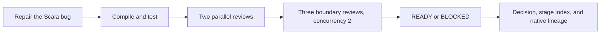

<div align="center">


# Raider

Scala workflows for coding agents and CI

[](LICENSE)
[](https://www.scala-lang.org/)
[](https://zio.dev/)
</div>

Raider runs coding agents from Scala. Ask an agent to work on a repository,
compose requests with typed Scala code, or run the same runtime in a local CI
job. Runs record model calls, tool calls, and results so you can inspect what
happened after the process exits.

The project is open source and in development. These guides describe the
current source checkout. SDK distribution and the full commit/PR/release
workflow remain on the [roadmap](docs/roadmap-12k.md).

## Choose a first task

Start with [setup and your first result](docs/onboarding.md), then use the
[practical handbook](docs/user-guide.md). Each case explains the input, command,
result, and files to inspect.

| I want to… | Example | What I get |
| --- | --- | --- |
| Run a workflow without a model account | [Release readiness](docs/onboarding.md) | A typed `READY` or `BLOCKED` report from supplied checks |
| Watch a coding agent fix a bug | [Billing repair](docs/user-guide.md) | A Scala patch and failing-to-passing boundary tests, using a local scripted provider |
| Turn a configuration problem into a finding | [Payment audit](docs/user-guide.md) | `AUDIT.json` with a file, line, impact, and recommended action |
| Write agent workflows in Scala | [Scala tutorial](docs/user-guide-repl.md) | Lazy requests, typed transformations, parallel reviews, bounded batches, and background jobs |
| Run an agent-assisted CI pipeline | [Local CI walkthrough](docs/user-guide-ci.md) | A repair, independent tests, five reviews, and a decision linked to run artifacts |
| Understand what happened in a run | [Lineage walkthrough](docs/user-guide-lineage.md) | Model/tool graphs, Scala projections, and the evidence behind a result |

## Get one result without a model account

Use JDK 21, sbt 1.11.4, and Python 3. Run these commands from the repository
root. The builder resolves the pinned Scala 3.9.0 and ZIO 2.1.26 dependencies;
see [setup](docs/onboarding.md) for `JAVA_HOME` and cache configuration.

```sh
sh scripts/build/user-examples.sh
RAIDER_CP=$(cat artifacts/user-examples/classpath.txt)
java -cp "$RAIDER_CP" raider.cli.Main run \
  --bundle artifacts/user-examples/task-summary.jar \
  --workflow task-summary \
  --input 'tests=pass,migration=pass,rollback=pending' \
  --out artifacts/user-examples/release-check --mock
```

The workflow evaluates the supplied statuses; it does not run a migration or
check your repository. Its expected output is:

```json
{"decision":"BLOCKED","passed":["migration","tests"],"pending":["rollback"],"action":"Complete: rollback."}
```

Here `BLOCKED` is a valid report, so the process exits 0. Replacing
`rollback=pending` with `rollback=pass` produces `READY`; malformed input fails
validation. [TaskSummary.scala](examples/user-guide/bundle/TaskSummary.scala)
shows the two typed programs joined with `andThen`.

## Write Scala that coordinates agents

After building, open the Scala REPL:

```sh
RAIDER_CP=$(cat artifacts/user-examples/classpath.txt)
RAIDER_PROVIDER=mock java -cp "$RAIDER_CP" raider.repl.Main
```

The REPL preloads `scout`, `worker`, `all`, and `batch`. For example, prepare a
review and a test plan for a discount that should apply at exactly 10,000 cents:

```scala
val code = "if subtotalCents > 10000 then 1000 else 0"
val policy = "A 1000-cent discount applies to purchases of at least 10000 cents."
val review = scout(s"$policy Review: $code. Give a boundary counterexample. No tools.")
val tests = worker(s"$policy Give expected discounts for 9999, 10000 and 10001 cents. No tools.")
val (finding, testPlan) = all(review, tests).run()
```

Constructing `review` and `tests` is lazy. `.run()` executes both requests and
returns their answers as a tuple. With `mock`, answers are fixed text marked
`[scripted-fixture]`; use the [provider setup](docs/onboarding.md) for model
answers. The [complete billing review example](examples/user-guide/repl/06billing-review.repl)
and [Scala tutorial](docs/user-guide-repl.md) explain the result checks and
composition types. Type `:quit` to leave the REPL.

## Follow a complete local CI case

The [billing CI application](examples/user-guide/ci/BillingCi.scala) works on a
disposable copy of the Scala fixture. It repairs a threshold bug, compiles and
tests the change independently, then asks for two general reviews and three
boundary reviews.



A [recorded live run](docs/examples/ci-pipeline/successful-run.json) reached
`READY`, exited 0, and recorded 24 nodes across six native roots. The
[CI walkthrough](docs/user-guide-ci.md) gives the full composition, provider
configuration, launch command, and result files. This example does not require
a forge-specific CI adapter.

## Read the Scala projection

A lineage projection describes the calls recorded in a run. The current renderer
produces typed `Program`/`Task` composition; evaluating that description produces
structural reports without calling models or tools.

There are two complete examples to read:

- [Six native projections from the live CI run](docs/examples/ci-pipeline/native-projections.md): the exact historical output, including its original comment-based format and data references.
- [Current unified Scala DSL projection](docs/examples/ci-pipeline/unified-lineage/lineage.scala): generated from the offline acceptance corpus, with [provenance and current wiring limits](docs/examples/ci-pipeline/unified-lineage/README.md).

The live CI application still launches six independent roots. The unified
example demonstrates one graph with linked child runs; the remaining live
wiring is described in the [lineage walkthrough](docs/user-guide-lineage.md).

## Reference and development

For signatures and implementation details, use the [API reference](docs/api.md)
and [architecture](docs/architecture.md). For contributing, use the
[contributor guide](docs/contributing.md), [execution board](docs/work/board.md),
and [roadmap](docs/roadmap-12k.md).

Scala workflows and repository commands run with your process permissions.
Use workspaces and code you trust. Keep provider credentials in environment
variables or a credential helper, outside Git.

MIT — see [LICENSE](LICENSE).
