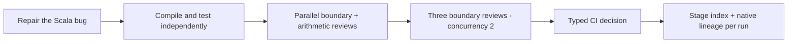

<div align="center">


# Raider

Scala workflows for coding agents and CI

[](LICENSE)
[](https://www.scala-lang.org/)
[](https://zio.dev/)
</div>

Raider runs coding agents from a Scala REPL and a headless CLI. Write a request,
compose several requests with Scala, or run a compiled workflow against a
repository. The runtime connects to a model, dispatches workspace tools, and
records the model and tool calls so you can inspect the work afterward.

The project is in development. You can build and use the current checkout;
SDK packaging and the full commit/PR/release workflow are on the [roadmap](docs/roadmap-12k.md).

## Start with the Scala REPL

Install JDK 21 and sbt 1.11.4. The example builder resolves the pinned Scala
3.9.0 and ZIO 2.1.26 dependencies, then writes the runtime classpath:

```sh
sh scripts/build/user-examples.sh
RAIDER_CP=$(cat artifacts/user-examples/classpath.txt)
RAIDER_PROVIDER=mock java -cp "$RAIDER_CP" raider.repl.Main
```

The REPL preloads `scout`, `worker`, `all`, and `batch`. It is a Scala console:
you can define case classes and functions, inspect types, and keep values between
submissions. The mock provider returns fixed answers with a `[scripted-fixture]`
marker. To get model answers, [configure a provider](docs/onboarding.md).

## Review a bug and plan its tests in parallel

A shop gives a flat $10 discount on purchases of at least $100. The code below
uses a strict comparison and misses the exact boundary. Give the review and the
test plan separate prompts, then combine their results:

```scala
val billingCode = "if subtotalCents > 10000 then 1000 else 0"
val billingPolicy = "A flat $10 (1000 cents) discount applies to purchases of at least $100 (10000 cents)."

val scoutAsk = scout(s"$billingPolicy Review this Scala expression: $billingCode. Identify the exact boundary defect and give one concrete input/output counterexample. Do not use tools. Reply concisely.").map(answer => ("boundary-review", answer))

val testAsk = worker(s"$billingPolicy For this Scala expression: $billingCode, Specify the expected discounts required by the policy, not the outputs of the buggy code. Return ONLY a JSON array of [subtotalCents, expectedDiscountCents] pairs for 9999, 10000 and 10001 cents. No markdown or tools.").map(answer => ("test-plan", answer))

val (review, plan) = all(scoutAsk, testAsk).run()
```

Creating an ask stores a description. `map` transforms its eventual answer;
`run()` starts execution. Here `all` runs both asks and returns their labeled
results as a tuple. The policy's expected test plan is:

```json
[[9999, 0], [10000, 1000], [10001, 1000]]
```

The complete [billing review example](examples/user-guide/repl/06billing-review.repl)
includes assertions for the labels and, with the live provider, the policy values.
[The Scala tutorial](docs/user-guide-repl.md) explains lazy asks, ordered batches,
background jobs, sessions, and typed programs with code you can follow.

## Run a Scala pipeline in local CI

The [billing CI application](examples/user-guide/ci/BillingCi.scala) combines
repository changes, deterministic checks, parallel reviews, and bounded review
batches. It runs through the headless runtime and writes a CI decision with
links to every agent run.



The example uses `Program.andThen` for stage types, `all` for independent
reviews, and `batch.collect` to retain individual review failures. Model success
and CI approval are separate results: a completed model call can still return a
blocking review, and the deterministic boundary tests must pass before approval.

[The CI walkthrough](docs/user-guide-ci.md) includes the full Scala composition,
local runner commands, output files, and the captured lineage. No forge-specific
configuration is needed.

## Let the agent change a repository

The billing repair example works in a disposable copy of a small Scala project.
It reads and searches the source, compiles it, observes the failing boundary
test, changes `>` to `>=`, and compiles and runs the tests again.

```sh
python3 scripts/quality/user_examples.py --only coding
```

The offline version uses a local stand that supplies a fixed sequence of tool
calls. Scala compilation, file edits, and subprocess execution happen in the
native runtime. The [handbook](docs/user-guide.md) covers the same task with a
configured model and shows how to inspect the resulting patch and test evidence.

| Task | Entry point | Result |
| --- | --- | --- |
| Repair a discount boundary | `--only coding` | Changed Scala implementation and passing below/at/above boundary tests |
| Audit payment configuration | `--only audit` | `AUDIT.json` with the source line, impact, and remediation |
| Review and propose tests | `--only repl-review` | Two labeled answers composed in Scala |
| Check release readiness | Bundle command below | JSON decision with passed checks, pending checks, and the next action |

These selectors belong to `python3 scripts/quality/user_examples.py`. With no
selector, it runs all ten examples and writes a report under
`artifacts/user-examples/verification-*/`.

## Put deterministic steps in a typed workflow

[TaskSummary.scala](examples/user-guide/bundle/TaskSummary.scala) composes two
stages: `Program[String, List[(String, String)]]` parses the input, and
`Program[List[(String, String)], String]` validates the checks and emits JSON.
The workflow joins them with `parseChecks.andThen(evaluate)`.

```sh
java -cp "$RAIDER_CP" raider.cli.Main run \
  --bundle artifacts/user-examples/task-summary.jar \
  --workflow task-summary \
  --input 'tests=pass,migration=pass,rollback=pending' \
  --out artifacts/user-examples/release-check --mock
```

```json
{"decision":"BLOCKED","passed":["migration","tests"],"pending":["rollback"],"action":"Complete: rollback."}
```

`BLOCKED` is a valid result, so this run exits successfully. Missing checks,
duplicate names, or unsupported statuses fail input validation with exit 21.
The workflow makes no model request.

## Read the lineage of a run

The billing run writes `lineage.scala` and `lineage-data.json` alongside its
summary, transcript, and event log. The generated Scala projection lists model
rounds and the tools dispatched in each round. An excerpt from the saved offline
billing run is:

```scala
// model("scripted-billing", round = 4) // data: j_1/round-4
  // tool("proc_run", recovery = "ReadOnly") // data: j_1/call-test-before
// model("scripted-billing", round = 5) // data: j_1/round-5
  // tool("fs_edit", recovery = "Mutating") // data: j_1/call-edit-discount
// model("scripted-billing", round = 6) // data: j_1/round-6
  // tool("proc_run", recovery = "ReadOnly") // data: j_1/call-compile-after
```

The `data:` references join the projection to records in `lineage-data.json`.
The event log and transcript hold the detailed tool results, including process
exit codes. [The lineage walkthrough](docs/user-guide-lineage.md) follows these
links through an actual run and explains the distinction between a composition
tree and the model/tool calls inside it.

## Where to go next

- [Setup and first run](docs/onboarding.md)
- [Coding and audit handbook](docs/user-guide.md)
- [Scala workflow tutorial](docs/user-guide-repl.md)
- [Local CI pipeline](docs/user-guide-ci.md)
- [Run lineage walkthrough](docs/user-guide-lineage.md)
- [API reference](docs/api.md) and [architecture](docs/architecture.md)
- [Contributing](docs/contributing.md), [execution board](docs/work/board.md), and [roadmap](docs/roadmap-12k.md)

Scala code, workflow bundles, plugins, and repository commands run with your
process permissions. Use workspaces and bundles you trust. Current live tool
examples use OpenAI-compatible providers. Anthropic tool definitions are
implemented; structured tool-result content mapping remains a separate W05 obligation. Credentials belong in an environment variable or helper, outside Git.

MIT — see [LICENSE](LICENSE).
