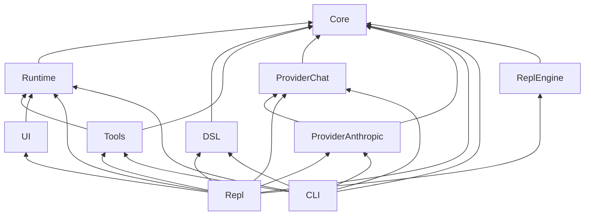
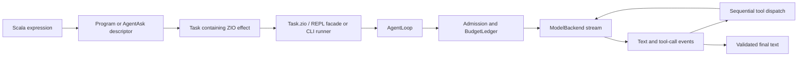
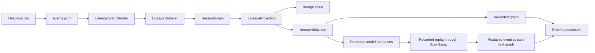

# Raider architecture

Raider is a Scala 3 application built on ZIO. Its core contracts describe model backends, tools, tasks, programs, jobs, and run events. The runtime executes agent turns and owns admission, accounting, delegation, and job lifecycle. The REPL and command-line runner provide different ways to enter that runtime.

This guide follows a request from Scala code through the runtime, describes the main module dependencies, and explains the event and lineage paths that exist in the current code. Links point to implementation files where practical.

## 1. Modules and dependencies

The production dependency direction is toward `core`. The diagram shows the main compile-time edges; test-only dependencies are described below it.



- [`raiderCore`](../modules/core/src/main/scala/raider/core/) contains the shared contracts and value types: `ModelBackend`, `ModelEvent`, `Tool`, `ToolRegistry`, `Program`, `Task`, `JobHandle`, errors, codecs, and traces. It depends on ZIO and zio-json.
- [`raiderRuntime`](../modules/runtime/src/main/scala/raider/runtime/) implements `AgentLoop`, admission and the budget ledger, jobs, delegation, runtime events, and lineage graph operations. It depends on core. `raiderTestkit` is a test-scope dependency of runtime, not a production backend.
- [`raiderDsl`](../modules/dsl/src/main/scala/raider/dsl/) contains typed composition such as `all` and `batch`, plus lineage data, storage, projection, and recorded-source support. It depends on core.
- [`raiderTools`](../modules/tools/src/main/scala/raider/tools/) implements workspace file and process tools. It depends on core and runtime.
- [`raiderProviderChat`](../modules/provider-chat/src/main/scala/raider/provider/chat/) implements the OpenAI-compatible Chat transport. [`raiderProviderAnthropic`](../modules/provider-anthropic/src/main/scala/raider/provider/anthropic/) implements the Anthropic Messages transport and reuses the Chat module's SSE framing.
- [`raiderReplEngine`](../modules/repl-engine/src/main/scala/raider/repl/engine/) embeds the pinned Scala 3 REPL. [`raiderRepl`](../modules/repl/src/main/scala/raider/repl/) wires the facade, compiler, providers, tools, and UI for interactive use. The REPL depends on the testkit for its mock wiring.
- [`raiderUi`](../modules/ui/src/main/scala/raider/ui/) holds tab and session UI state over runtime events. It depends on runtime and includes JLine terminal support.
- [`raiderCli`](../modules/cli/src/main/scala/raider/cli/) provides the headless runner, chat, artifacts, and replay command. It depends on core, DSL, runtime, tools, and both provider modules. It does not depend on the REPL engine or UI, so the headless distribution does not include the Scala compiler or JLine.
- [`raiderCliFixtures`](../modules/cli-fixtures/src/main/scala/raider/fixtures/) supplies a compiled demo workflow to CLI tests.

These edges are defined in [`build.sbt`](../build.sbt). In particular, the REPL, CLI, and UI are not three independent agent runtimes: their work reaches the same runtime loop, while each frontend has its own input and presentation code.

## 2. From a Scala expression to a model turn

A REPL expression first describes work. It reaches a backend only when an execution method runs it. `Task` is a lazy wrapper over a ZIO effect; `Task.zio` is the boundary that exposes that effect to the launcher. The DSL composes tasks at this same boundary rather than defining a second execution engine.



The layers have distinct responsibilities:

1. **Scala expression and descriptor.** `scout(prompt)` in the REPL creates an `AgentAsk[String]`; calling `.map` adds typed post-processing. A `Program[I, O]` accepts an input and returns a `Task[O]`. Constructing either does not make a provider request. See [`Program`](../modules/core/src/main/scala/raider/core/program.scala), [`Task`](../modules/core/src/main/scala/raider/core/task.scala), and [`FacadeOps`](../modules/repl/src/main/scala/raider/repl/facade/FacadeOps.scala).
2. **Composition.** `all(taskA, taskB)` returns a task whose two branches run in parallel and whose result is a typed tuple. It fails fast and interrupts its sibling on failure. `all(programA, programB)` instead creates a program that will build that task for an input. The implementation is in [`Composition.scala`](../modules/dsl/src/main/scala/raider/dsl/composition/Composition.scala).
3. **Interpreter and facade.** In the REPL, `.run()` calls `Task.zio` and executes it on the REPL runtime. `AgentRef.ask` and the CLI runner also reach the runtime loop; the REPL-specific methods are extension methods rather than core contract members. See [`FacadeOps.scala`](../modules/repl/src/main/scala/raider/repl/facade/FacadeOps.scala) and [`HeadlessRunner.scala`](../modules/cli/src/main/scala/raider/cli/run/HeadlessRunner.scala).
4. **Agent loop.** [`AgentLoop.runText`](../modules/runtime/src/main/scala/raider/runtime/loop/AgentLoop.scala) validates the request and round limit, streams model events, dispatches ready tool calls, appends matched tool results to the conversation, and continues until it receives valid final text or returns a typed error. Partial tool-argument deltas are never executed. Unknown tools and malformed arguments are sent back as structured feedback; definitive tool failures fail the run.
5. **Provider and tools.** A `ModelBackend` translates a provider protocol into normalized `ModelEvent`s. When the model produces `ToolCallReady`, the loop looks up the named tool, validates its JSON arguments, and invokes it. Tool calls run sequentially in model order under a tool slot. The loop does not blindly retry a mutating call after an ambiguous outcome. See [`backend.scala`](../modules/core/src/main/scala/raider/core/backend.scala), [`tool.scala`](../modules/core/src/main/scala/raider/core/tool.scala), and [`CodingToolset.scala`](../modules/tools/src/main/scala/raider/tools/CodingToolset.scala).

### Example: parallel billing review

The repository's [`06billing-review.repl`](../examples/user-guide/repl/06billing-review.repl) builds two prompts from one Scala expression and billing policy. `scoutAsk` requests a defect explanation; `testAsk` asks for expected boundary cases as JSON. Both descriptors add a result label with `.map`, then `all(scoutAsk, testAsk).run()` produces a pair of labeled answers.

```scala
val billingCode = "if subtotalCents > 10000 then 1000 else 0"
val billingPolicy = "A flat $10 (1000 cents) discount applies to purchases of at least $100 (10000 cents)."
val scoutAsk = scout(s"$billingPolicy Review this Scala expression: $billingCode. Identify the exact boundary defect and give one concrete input/output counterexample. Do not use tools. Reply concisely.").map(answer => ("boundary-review", answer))
val testAsk = worker(s"$billingPolicy For this Scala expression: $billingCode, Specify the expected discounts required by the policy, not the outputs of the buggy code. Return ONLY a JSON array of [subtotalCents, expectedDiscountCents] pairs for 9999, 10000 and 10001 cents. No markdown or tools.").map(answer => ("test-plan", answer))
val (review, plan) = all(scoutAsk, testAsk).run()
```

In the complete example, the prompts include the buggy expression `subtotalCents > 10000` and a policy that applies a 1000-cent discount at and above 10000 cents. The REPL's mock mode runs the Scala and checks that both labeled responses are non-empty. With the configured OpenAI-compatible path, the example also parses the returned plan and checks the policy cases: 9999 → 0, 10000 → 1000, and 10001 → 1000. Mock responses demonstrate wiring and assertions; they are not model verification.

This foreground REPL example prints its results. It does not create the CLI run bundle or lineage artifacts described in §7.

Each descriptor becomes its own agent run when the combined task executes. The REPL session supplies the same admission service and limits to both runs, while each run receives its own root ID. The `all` composition does not merge their accounting roots. If one branch fails, `all` interrupts the sibling.

## 3. Ownership, budgets, and cancellation

Each `AgentLoop` is created with a backend, tool registry, model name, `Admission`, and a root ID. Admission controls model and tool concurrency and uses the shared `BudgetLedger` for attempt reservations. Budget limits include the optional hard USD cap, maximum concurrent model and tool calls, children, nesting depth, attempts, and queue capacity. Configuration is validated before a session or run starts.

For each model or tool dispatch, admission follows a defined order: check queue capacity, wait for a concurrency permit, recheck cancellation, reserve budget, and then dispatch. A successful call settles against observed cost. If the price is unknown, it is recorded as unpriced; an unknown estimate is not treated as free. An unknown-price attempt is refused when a hard cap is required.

Cancellation accounting depends on whether dispatch began:

- Cancellation while waiting for a slot makes no reservation.
- Cancellation after acquiring a slot but before dispatch releases the reservation.
- Interruption during provider or tool dispatch leaves the attempt charged as uncertain, because the external operation may have completed.

`JobManager` owns background jobs and their terminal status. REPL `start` returns a job handle; `await` observes the result of that job and does not start it again. Delegated children share their parent's root accounting and job manager. Awaiting a child does not hold a model slot, so a child can run when `maxConcurrentLlm` is one. The awaiting parent does hold a tool slot, which is why delegation requires at least two tool slots. Owner or UI cancellation uses an out-of-band path to the job manager, so it does not need another model turn. Child deadlines use the same path; if cleanup cannot confirm cancellation before its grace period, the result is reported as uncertain.

See [`Admission.scala`](../modules/runtime/src/main/scala/raider/runtime/admission/Admission.scala), [`BudgetLedger.scala`](../modules/runtime/src/main/scala/raider/runtime/budget/BudgetLedger.scala), [`JobManager.scala`](../modules/runtime/src/main/scala/raider/runtime/jobs/JobManager.scala), and [`DelegationToolset.scala`](../modules/runtime/src/main/scala/raider/runtime/delegate/DelegationToolset.scala).

## 4. Runtime events and UI state

Runtime events provide an observation path for status and progress. The runtime publishes envelopes to an `EventHub`; UI consumers reduce those envelopes into state or render status. This path does not control the agent loop. A slow observer must not become a second execution scheduler.

The hub separates reliable events from diagnostics. Reliable events use bounded waiting and can return a typed backpressure error; diagnostic events are non-blocking and may be dropped with a count. Envelopes have per-job sequence numbers. Reliable and diagnostic forwarders are independent, so consumers should order by sequence rather than assume arrival order across those classes.

The loop reports model and tool activity, but job status and the terminal event belong to the job layer. `StatusLedger` publishes the status transition and exactly one terminal event. `SessionReducer` applies envelopes to snapshots and rejects events after a terminal snapshot. UI state remains a consumer: for example, `SessionRegistry` stores tab history and scrollback, while status views render snapshots.

Optional event bindings mean a loop can run without a hub. Emission failures are absorbed and do not change the run result. See [`events.scala`](../modules/runtime/src/main/scala/raider/runtime/events/events.scala), [`hub.scala`](../modules/runtime/src/main/scala/raider/runtime/events/hub.scala), [`reducer.scala`](../modules/runtime/src/main/scala/raider/runtime/events/reducer.scala), [`StatusLedger.scala`](../modules/runtime/src/main/scala/raider/runtime/jobs/StatusLedger.scala), and [`SessionRegistry.scala`](../modules/ui/src/main/scala/raider/ui/SessionRegistry.scala).

## 5. Frontends and providers

### REPL

The REPL embeds the pinned Scala 3 compiler in-process. Its engine uses a classloader boundary: interpreter-world classes load self-first, and the prelude builds backend, tools, and session objects within that interpreter world. The facade exposes `scout`, `worker`, `ask`, `start`, `all`, and related operations over the common runtime. Interactive streaming output is optional. The REPL can select the OpenAI-compatible or Anthropic-compatible provider when configured.

The Anthropic REPL path currently does not send tool definitions, so this wiring does not provide tool-call parity. This is a known limitation, not a property of `AgentLoop` or a claim about the CLI's provider path. See [`Main.scala`](../modules/repl/src/main/scala/raider/repl/Main.scala), [`DottyReplEngine.scala`](../modules/repl-engine/src/main/scala/raider/repl/engine/DottyReplEngine.scala), and [`LiveCredentials.scala`](../modules/repl/src/main/scala/raider/repl/LiveCredentials.scala).

### CLI

The headless CLI loads a validated bundle or selects a built-in agent, performs preflight before spending, writes run artifacts, and maps outcomes to stable exit-code families. The interactive `raider chat` frontend adds streaming display, session persistence, and the `:fix` compile/fix loop. Neither path embeds the Scala REPL compiler. See [`CliArgs.scala`](../modules/cli/src/main/scala/raider/cli/run/CliArgs.scala), [`HeadlessRunner.scala`](../modules/cli/src/main/scala/raider/cli/run/HeadlessRunner.scala), and [`ChatLoop.scala`](../modules/cli/src/main/scala/raider/cli/chat/ChatLoop.scala).

Credentials are resolved from environment variables or a configured helper reference. The CLI rejects an API key passed through `--api-key`; secrets do not belong in command arguments. Provider transport maps authentication, rate-limit, unavailable-server, and protocol failures to typed errors. The shared SSE framer handles byte-level UTF-8 boundaries. A rate-limit retry decorator retries 429 responses only, with a bounded schedule; other failures are not retried by that decorator. See [`Credentials.scala`](../modules/cli/src/main/scala/raider/cli/run/Credentials.scala), [`SseFramer.scala`](../modules/provider-chat/src/main/scala/raider/provider/chat/stream/SseFramer.scala), and [`RateLimitRetries.scala`](../modules/runtime/src/main/scala/raider/runtime/display/RateLimitRetries.scala).

## 6. Workspace tools and self-hosting

The built-in coder uses the workspace toolset: file read, search, edit, patch, tree, and process execution. Tools operate with the process permissions and workspace configuration supplied to them. The REPL and Scala plugins run trusted Scala code with the process's permissions; tool policy does not sandbox arbitrary Scala.

The coder prompt describes a read, understand, change, compile, fix, test, summarize workflow. That prompt is guidance for the agent; the runtime does not guarantee that every model follows those steps. Process output is bounded and includes parsed summaries for known compile and test commands. The quality gate policy is documented in [`quality-gates.md`](quality-gates.md). See [`CoderPrompts.scala`](../modules/cli/src/main/scala/raider/cli/CoderPrompts.scala), [`CodingToolset.scala`](../modules/tools/src/main/scala/raider/tools/CodingToolset.scala), and [`ProcessTool.scala`](../modules/tools/src/main/scala/raider/tools/process/ProcessTool.scala).

## 7. Run events and lineage artifacts

The implemented headless lineage path starts with a settled CLI run. The runner exports that run's event stream, the lineage reader parses it, the reducer constructs a `SessionGraph`, and the projection writes `lineage.scala` plus `lineage-data.json`. The generated Scala file contains the graph's program and task structure; node data such as prompts and tool arguments is stored in the JSON resource. The graph is a projection of events, not the source of truth.



The run directory also contains `run.json`, `summary.md`, and `transcript.json`. A settled run writes the two lineage files alongside these artifacts. The summary includes the lineage graph hash; a lineage-artifact write failure is reported as unavailable in the summary and does not replace the run's exit status. The user guide's artifact example describes this output for a CLI run; a standalone REPL `.run()` such as the billing example does not produce this directory.

`raider replay <run-dir> --workspace <dir>` is implemented for recorded replay. It uses recorded model responses, runs the shared agent loop with budget admission, and compares the resulting graph with the recorded graph. A matching graph returns the match verdict; a mismatch reports the first divergent node. The product replay command does not make live provider calls. Live rerun with a model, unified multi-job event export, and wire schema additions for phase and recovery-class data remain outside the implemented replay path. For the full status and artifact layout, see [`lineage.md`](lineage.md), [`RunLineageArtifacts.scala`](../modules/cli/src/main/scala/raider/cli/run/RunLineageArtifacts.scala), [`LineageReducer.scala`](../modules/runtime/src/main/scala/raider/runtime/lineage/reduce/LineageReducer.scala), [`LineageProjection.scala`](../modules/dsl/src/main/scala/raider/dsl/lineage/proj/LineageProjection.scala), and [`ReplayCli.scala`](../modules/cli/src/main/scala/raider/cli/lineage/ReplayCli.scala).

## 8. Further reading

| Topic | Guide or implementation |
| --- | --- |
| Public runtime contracts | [`runtime-contracts.md`](runtime-contracts.md) |
| DSL and REPL usage | [`user-guide.md`](user-guide.md), [`product-repl.md`](product-repl.md) |
| Provider protocols | [`provider-protocols.md`](provider-protocols.md) |
| Plugins | [`plugins.md`](plugins.md) |
| Quality checks | [`quality-gates.md`](quality-gates.md) |
| Session lineage and current status | [`lineage.md`](lineage.md), [ADR-027](adr/ADR-027-session-lineage.md) |
