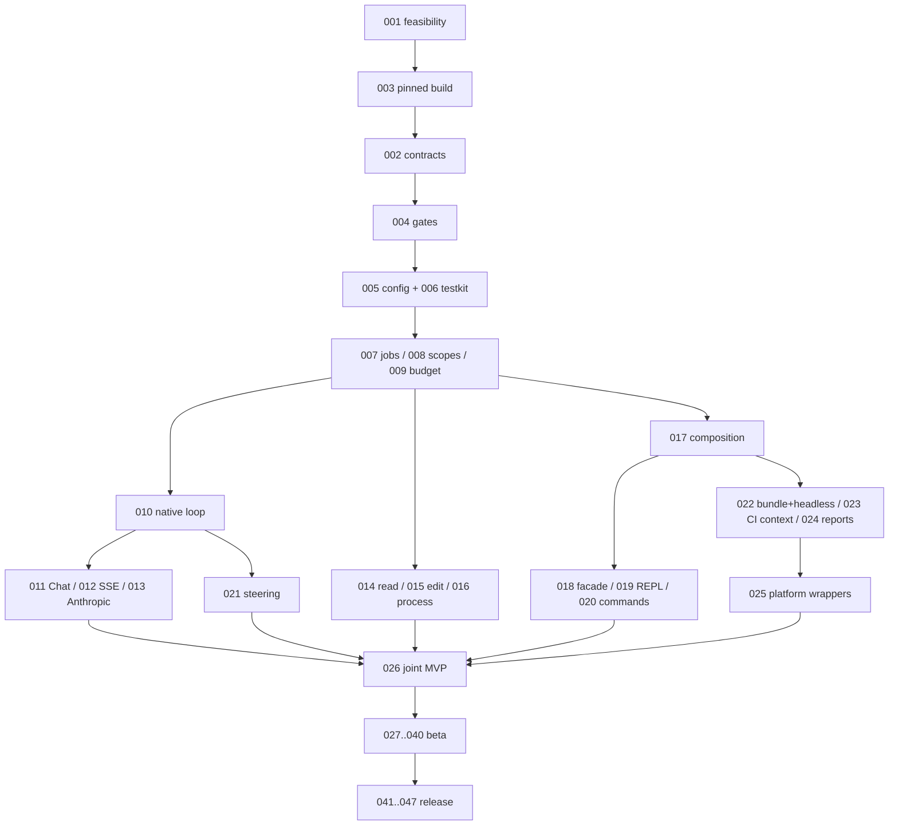

<!-- Translated from Russian original. Key terms preserved as-is. -->

# Development stages

Current clarification, 2026-10-03: [working target](working-product.md), [parallel runbook](parallel-development.md), [stage-aware gates](quality-gates.md). The old IDs are retained; milestone acceptance and a useful coding-agent result are distinct.

## 1. Priority and iteration size

The primary product is a portable headless agent runner inside a CI job. All three scenario classes are in scope: PR/MR review, patches with actual checks, and research/generation/checks. The REPL is for creating and debugging the same Programs; the compiler is separate from the production runner. The native loop works without Yabanin and supports two first-class protocols: OpenAI-compatible Chat and Anthropic-compatible Messages. Yabanin is an optional integration.

Each card defines a verifiable contract. If an implementation exceeds one clear behavior/interface, split it before assignment into child cards `RAI-NNN.a/b/c` with the same acceptance/allowed-path boundaries and independent records. The parent is accepted only when all parts are accepted. Do not assign an entire transport/REPL/artifact subsystem as one large diff to a weaker model. [Cards](tasks/README.md) define milestone scope; [model workflow](model-workflow.md) constrains each implementation packet.

## 2. Milestones

| Milestone | Cards | Result | Exit gate |
| --- | --- | --- | --- |
| M0a feasibility/foundation | 001–006 | Headless+REPL proof, pinned build, compile contracts, gates, config/mock | bootstrap → self/static/contracts |
| M0b runtime/protocols | 007–017 | Jobs/scopes/budgets/native loop, both HTTP wires, local tools, composition | runtime/transport/tools/contracts |
| M0c product surfaces | 018–026 | REPL facade, bundle/headless CI, reports/exits/trust, thin platform templates | ci + real compiler/PTY + joint MVP |
| M1 beta ecosystem | 027–040 | Journal, typed agents, loaders/plugins/imports/bridges/sessions, optional Yabanin/eval export | full + compatibility + declared integration |
| M2 release quality | 041–047 | Protected task eval, accounting, soak, JVM/OCI package, dev CI/docs/release | release + supported integrations |
| P2 optional | 048–053 | Daemon, registered-step recovery, shared caps, live comparisons, quorum, MCP | Separate design/capability acceptance |
| Yabanin companion | YB-RAI-01–03 | Harness adapter, real executor, analytics | Yabanin-specific gates |

Numbers are RAI-ID suffixes. There are 53 Raider cards and 3 optional companion cards. This is scope, not a calendar promise. Estimate throughput/remaining complexity after M0a; compiler/protocol feasibility matters more than an arbitrary date.

## 3. Critical path



Exact card dependencies take priority. The main runtime does not wait for Yabanin companion PRs. Native/beta release capabilities can be accepted separately from optional bridge support; an unsupported capability must be labeled explicitly, not called ready.

## 4. M0a: feasibility and frozen contracts

001 checks real Scala REPL embedding/classloader/prelude/JLine/signals and headless packaged execution. Measure cold start, memory, and cancellation; preserve a reproducer and ADR. Do not build a production compiler adapter before proof. If the official engine requires a large fork, consider a narrow shell/engine adapter; a custom parser for a few commands does not meet the requirement.

003 pins the build/toolchain; 002 fixes Program/Task/Job/Workflow/Pipeline/checks/codecs/backend events/bundle/context/output schemas and positive+negative compile fixtures. 004 creates the command registry/classifier/fingerprints/evidence. Do not defer quality until release; missing prerequisites remain unavailable, not green skips.

005 freezes config/trust/policies/provider roles. 006 scripted backend/TestClock/bounded fake tools lets all ordinary gates run without a paid model.

## 5. M0b: native vertical slice

Job registry → scope ownership → root ledger → loop → both wires. The loop does not depend on provider-specific messages; adapters translate complete tool rounds/usage/errors. Anthropic Messages is not a fake Chat wrapper. Model/provider registry discovery is optional. Standalone acceptance runs without a YABANIN environment/service/module.

Tools operate only in a temporary workspace. Read containment, hash-precondition edits, process groups/cwd/env/timeouts, and sandbox capabilities are checked separately. Parallel writers are serialized or use separate worktrees. Native delegation starts only after limits/profile-registry/capability intersection; a model permit is not held while joining a child.

Composition is unified: apply builds a Task, andThen is sequential, all/batch are bounded parallel, and fork/join are scoped. The deadline includes queue/retry/tools; lazy construction/printing does not dispatch.

## 6. M0c: one scenario in CI and the REPL

First production-shaped acceptance:

```text
raider run --bundle pipelines.jar --workflow audit --ci generic \
  --context ci-context.json --input "Check the project" --mock --out artifacts/raider
```

The scenario runs non-TTY with closed stdin, validates trusted checks, saves result/events/JUnit/summary, cancels children on SIGTERM, and returns a truthful exit. The same bundle/Program runs on GitHub/GitLab environment fixtures. The runner classpath excludes the compiler/JLine. The presence of YAML does not mean hosted integration is ready: separate evidence from a real job is required.

Local debugging:

```scala
scout.ask("Assess the project")
val job = scout.start("Investigate the parser")
job.send("Pay particular attention to UTF-8")
job.await
(scout andThen reviewer).ask("Review the architecture")
all(scout("Study the cache"), reviewer("Study retries")).run()
batch(List("auth", "stream"), parallelism = 2)(scout(_)).run()
```

The Prelude provides profiles/launch capability; the workflow body does not use a blocking facade. Compiler errors preserve bindings; background output does not disrupt the prompt; cancellation is owner-specific. Setup provides a path for missing credentials and an honest mock that is always available.

The MVP excludes durable arbitrary-Scala resume, shared cross-CI caps, a daemon, and external backend parity. Typed pipeline codecs/checks are already in M0; advanced typed model repair/context compaction are in M1. Native baseline role profiles are not claimed to be exact copies of pi/OpenCode before importer cards.

## 7. M1: beta extensibility and Yabanin

Journal/schema precede archives/sessions/eval exports. Importers carry over policy semantics and provenance, not just prompts. Binary JVM plugins are trusted code; TypeScript extensions require an external backend, not JVM loading.

Pi RPC/OpenCode HTTP have their own lifecycle/tool/cost/cancel capabilities; false parity blocks launch when a guarantee is required. Pin versions and use a checked corpus. Do not claim unsupported nested attempt accounting is complete.

Yabanin-first integration for users who want a gateway: existing `yb ci exec --session=on -- raider run ...`, inherited child env/labels/session owner. Native connection comes later, followed by labels/doctor/root keys/stand/eval. Do not mint a second session on top of inherited ybs_. Required gateway mode does not bypass direct-provider denial. Yabanin companion changes belong only in separate PRs under its own rules.

## 8. M2: release evidence

Prove from a clean distribution: standalone support for both wires, CI/REPL DSL, owned cleanup, bounded resource usage, truthful costs, protected checks, schema/hash consistency, safe artifact rendering, pinned OCI/JVM installation, and a supported platform matrix. Compilers/protocols are not considered ready based on a mock interface.

The base full release does not require a deployed Yabanin; a separately advertised Yabanin capability requires a real pinned mock-upstream stand. The same applies to external engines. Do not publish a release, license/signatures, or spend without the corresponding owner decisions.

Native-image is not a goal: a dynamic REPL/compiler is a separate feasibility question. The headless JVM/OCI split already addresses production compiler overhead without that dependency.

## 9. Owner result review

For each milestone: one acceptance command, one evidence-verification command, an actual report, and known limitations. The owner checks terminal/CI outputs, the job tree, cleanup, and costs/uncertainty. A model summary is not evidence.

A card is done when dependencies are accepted, contract cases pass, required gates are passed/current, a fresh review is complete, and an actual work record exists. A milestone is done when the joint scenario is accepted and all blockers are closed. A release is done when there is an immutable source/dependency/policy fingerprint, validated artifacts, and evidence for declared capabilities.

Deferred owner decisions: license/distribution ownership; supported OS/version matrix; live provider account/cap; performance reference machine; P2 budget authority. Local mock work can continue before these decisions; paid calls/publication are not thereby authorized.
