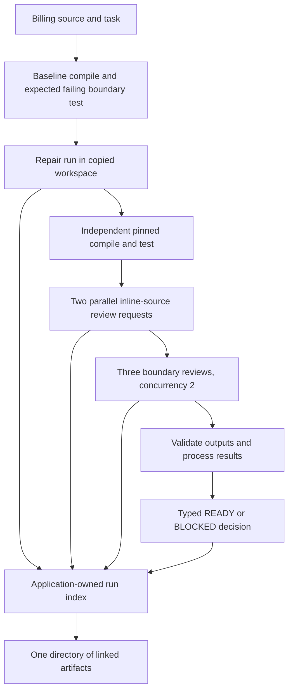
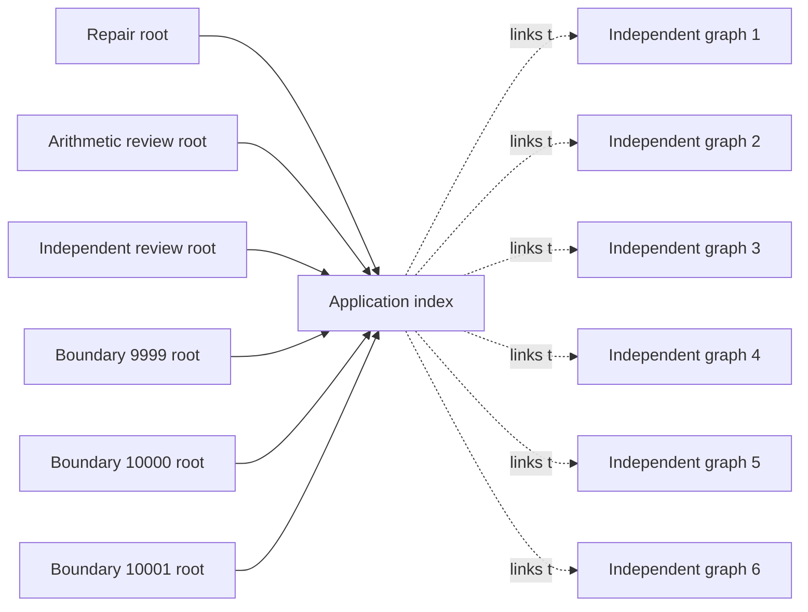

# A local Scala workflow for CI

This example repairs a deliberately incorrect Scala billing rule, checks the result with an independent compiler and test process, asks two reviewers to inspect inline source, checks three discount boundaries, and writes a typed decision plus an index of the run artifacts. The workflow is written in Scala and uses Raider's current `Program`, `Task`, composition, headless runner, and lineage APIs.

The application is in [`BillingCi.scala`](../examples/user-guide/ci/BillingCi.scala). Its build and output layout are assembled by the repository-owned [`user-ci.sh`](../scripts/build/user-ci.sh). This guide separates the application's index of several runs from the native lineage graph written by each headless run: each native graph has its own root and budget.

## What the application does

The application works on a copy of the checked-in billing fixture. Its order is deliberate: make a repair, independently verify it, gather parallel review results, check boundary cases, then derive a typed release decision and write the index. Review stages receive source as input and have no mutation authorization. Compiler and test results come from actual process exits, not from model summaries.



The graph describes orchestration and file ownership in the example. It does not claim that Raider's native lineage format contains a unified phase graph for these stages. The application index links separate headless run directories; it is an application-owned document, not native lineage or a shared accounting ledger.

The two reviewer prompts request analysis of the inline source and forbid tools. The application rejects a reviewer result if it observes a tool call or any file in that review's workspace. The current `coder` agent still has the full registered tool set and process permissions; these prompt and postcondition checks do not enforce a read-only capability boundary or sandbox arbitrary process effects.

## Build and launch

The build script compiles the Scala application and writes a classpath containing the example plus its runtime dependencies, and a runtime classpath for child CLI processes:

```sh
sh scripts/build/user-ci.sh
RAIDER_CI_CP=$(cat artifacts/user-ci/classpath.txt)
RAIDER_RUNTIME_CP=$(cat artifacts/user-ci/runtime-classpath.txt)
```

Configure the owner's approved OpenAI-compatible endpoint, model, and coding-plan credentials privately in the environment or credential helper. Keep credential values out of source, shell history, argv, the index, and run reports. Then launch the example with the explicit live approval switch:

```sh
RAIDER_LIVE_APPROVED=1 java -cp "$RAIDER_CI_CP" demo.BillingCi \
  "$RAIDER_RUNTIME_CP" \
  artifacts/user-ci/run \
  examples/user-guide/fixture
```

The three arguments are the runtime classpath used by child runs, the output directory, and the source fixture workspace. The application copies the fixture into `<artifact-output-dir>/workspace` and runs the repair there. It writes `RUNBOOK.md` and a pinned checker into the copy. The baseline checker compiles the Scala source/tests and expects only the exact-threshold test to fail; after repair, the same checker must exit zero and report all three boundaries passing. The original fixture stays available for comparison.

`RAIDER_LIVE_APPROVED=1` is an explicit opt-in for this example's provider calls. It does not supply credentials or select a different provider. The coding-plan endpoint/model configuration must already be present through the owner's private setup. Do not add a provider key or URL containing credentials to this command.

The app requires `RAIDER_PROVIDER=openai`, `RAIDER_BASE_URL`, `RAIDER_MODEL=glm-5.3-flash`, and either `RAIDER_API_KEY` or `RAIDER_API_KEY_CMD`, in addition to `RAIDER_LIVE_APPROVED=1`. Configure those names through the approved private environment or helper before running the command. The app passes each stage to [`CliArgs.parse`](../modules/cli/src/main/scala/raider/cli/run/CliArgs.scala) and calls [`HeadlessRunner.run`](../modules/cli/src/main/scala/raider/cli/run/HeadlessRunner.scala) with an explicit generic CI selection. The current CLI parser does not expose a `--ci` flag; the app writes a [`CiContext`](../modules/cli/src/main/scala/raider/cli/run/CiContext.scala) JSON file with `ci="generic"` and `trusted=false` for each invocation. The runner's artifact view redacts the repository, ref, SHA, pipeline, and job fields of this untrusted context.

## The Scala composition

[`Program[I, O]`](../modules/core/src/main/scala/raider/core/program.scala) describes a workflow from input type `I` to output type `O`. Calling `apply` constructs a lazy [`Task[O]`](../modules/core/src/main/scala/raider/core/task.scala); it does not start the workflow. `andThen` connects two compatible program types, and `mapOutput` transforms a result. `Task` wraps a ZIO effect and runs only at the interpreter boundary.

The project also provides parallel composition over the same `Task` interpreter in [`Composition.scala`](../modules/dsl/src/main/scala/raider/dsl/composition/Composition.scala). `all(first, second)` returns a tuple when both tasks succeed and fails fast if one fails. `batch.collect(inputs, parallelism)(run)` keeps input order, bounds concurrent work, and returns domain failures as typed `BatchOutcome.Failed` values. It propagates external interruption and defects instead of hiding them.

The billing application connects the repair run to a typed verifier, then composes review and boundary runs. This excerpt is taken from [`BillingCi.scala`](../examples/user-guide/ci/BillingCi.scala); local names and omitted setup are defined in that file:

```scala
repairProgram = agentProgram("billing-repair")
verifyProgram = Program.fromFunction[AgentOutput, VerifiedRepair]("verify-repair") { attempt =>
  Task(ZIO.attemptBlocking {
    val evidence = validateRepair(setup, attempt)
    VerifiedRepair(evidence.sourceChanged, readUtf8(setup.source), attempt)
  }.mapError(error => RaiderError.OutputValidation(
    Option(error.getMessage).getOrElse("repair verification failed")
  )))
}
repairAndVerify = repairProgram.andThen(verifyProgram)
repaired <- Task.zio(repairAndVerify(repairInput))

reviews <- Task.zio(all(
  reviewProgram(reviewsInput._1),
  reviewProgram(reviewsInput._2)
))

boundaryOutcomes <- Task.zio(batch.collect(boundaryInputs, parallelism = 2) { input =>
  boundaryProgram(input)
})
```

The verifier turns the native repair attempt into `VerifiedRepair` only after checking the actual native exit, recorded tool calls, workspace inventory, source change, inclusive threshold, and pinned checker hash. The two review programs run concurrently and return a tuple. `batch.collect` runs the three boundary inputs with concurrency two and preserves their input order. The source then checks the structured JSON fields and combines only validated results into its typed `Decision`.

The application serializes its decision with this source-defined type:

```scala
final case class Decision(
    verdict: String,
    repairCheckExit: Int,
    sourceChanged: Boolean,
    reviewPasses: Int,
    boundaryPasses: Int,
    requiredBoundaryCases: List[Int],
    detail: String
) derives JsonCodec
```

The index uses a separate `StageRef` for each stage. It records a status, the native work directory and root ID when a headless call occurred, the native exit code, a lineage summary and artifact paths, a stage verdict, and the answer file. `Decision` describes the application-level result; the native run records continue to describe each individual invocation.

The baseline checker must exit 1 with exactly `FAIL exact-threshold`; this establishes the planted defect after successful compilation. The repair prompt asks for the smallest change to `Discount.scala` and tells the agent to follow the generated runbook. A postcondition checks that the source changed to use the inclusive `s >= 10000` threshold, no files were added or removed, other fixture files remain byte-identical, the pinned checker hash is unchanged, and the native repair run has a parsed transcript and tool calls. The independent final checker then must exit 0 and include `DiscountSpec: PASS 3 boundaries`.

The requirements and arithmetic reviews receive the current source inline with a request for JSON containing `verdict` and `reason`; their result is accepted only if it parses, says `PASS`, includes a non-empty reason, the workspace remains empty, and the transcript has no tool calls. The boundary reviews process 9999, 10000, and 10001 cents in input order. Each must return valid JSON containing the subtotal, policy-derived expected discount, source-derived observed discount, `PASS`, and a non-empty reason. If either general review fails or fewer than three boundary outputs pass validation, the typed decision is `BLOCKED`.

## Independent results and exit codes

Read process results directly. A `proc_run` tool invocation can return successfully while the command it launched exits nonzero; the application must inspect the recorded process exit code and output. The repair agent's own text is not proof that compilation or tests passed.

The typed decision and process exit are separate values:

| Outcome | Application exit | Meaning |
| --- | ---: | --- |
| `READY` | 0 | All required evidence was present and accepted. |
| `BLOCKED`, invalid arguments, invalid live configuration, or another failed run | 1 | The workflow did not reach its accepted decision. |
| Pipeline deadline exceeded | 24 | The index is marked `UNKNOWN`; a stage outcome may be incomplete. |

These are the application's declared exits. The native `RunResult` for an individual headless invocation has its own `status`, `exitCode`, `checks`, and `output` fields. The runner's `taskVerdict` is `None`; an agent's text is not a verifier verdict. The runner's `checks` array includes a `bundle-preflight` check whose outcome is currently marked `Failed` even when its detail is `preflight ok`. The application bases its decision on the actual headless exit, independent compiler and test results, and its own checked structured review data rather than that check entry.

## Native runs and the application index

Each headless run writes its own `work-<id>` directory. Depending on the reached execution stage, it can contain `run.json`, `events.jsonl`, `summary.md`, `transcript.json`, and lineage artifacts `lineage.scala` and `lineage-data.json`. The run summary records the native root's status, exit code, number of event envelopes, and lineage hash/node count when the event stream reduces successfully.

This application launches six independent headless roots: one repair, two parallel reviews, and three boundary reviews. The baseline and final pinned compile/test commands run as local processes; they are recorded in their own logs rather than as additional native roots. Each native invocation has its own default `maxAttempts=400` and a 120-second deadline; the whole pipeline has a five-minute deadline. The application index explicitly records that there is no shared pipeline budget. The six agent invocations can each include multiple model rounds; there is no aggregate request or USD cap. Stage records link each native root ID, work directory, exit code, lineage summary, and lineage files. The application index does not merge the native graphs into a native phase tree or claim shared root accounting or durable recovery.



The index is `pipeline-index.json`; the typed release result is also written to `decision.json`. Use the emitted index to find each native run; do not guess run IDs. Each run's `events.jsonl` is the checkpoint for its own native graph. The index `budgetNote` records the independent per-run attempt limit and the lack of a shared pipeline budget.

## Captured CI run and lineage

The [first captured pipeline](examples/ci-pipeline/README.md) ran through the
coding-plan gateway with requested model `glm-5.3-flash`. The repair changed the
Scala comparison, and the independent compiler and three boundary assertions
passed. The application still returned a `BLOCKED` decision because several
model answers wrapped their JSON in Markdown and failed the original decoder.

```json
{"verdict":"BLOCKED","repairCheckExit":0,"sourceChanged":true,"reviewPasses":1,"boundaryPasses":1,"requiredBoundaryCases":[9999,10000,10001],"detail":"One or more model review stages did not satisfy the exact typed contract."}
```

All six native runs had exit code 0. This makes the distinction visible: successful
model execution is one input to the CI decision, while the application validates
the actual result fields before accepting the stage. The [captured graphs](examples/ci-pipeline/first-blocked-run.json)
contain 18 nodes for repair and one model node for each of the five inline review
requests. Native tool calls appear only in the repair graph.

The first application also hung during process exit and required a coordinator
stop; its original failed receipt is retained. The current example moves process
exit after the managed ZIO effect, isolates each parallel context file, and
preserves native artifact references when a semantic check fails. Its JSON parser
accepts a single complete code fence, then applies the full decoder and exact
policy checks. A new execution of that revision must have its own capture.

### Inspect a stage

The pipeline index points at each native run. Use the actual `nativeWorkDir`
from the index; run IDs are assigned at execution time:

```sh
RAIDER_PIPELINE=artifacts/user-ci/run
RAIDER_STAGE=$(jq -r '.stages[] | select(.name == "repair") | .nativeWorkDir' \
  "$RAIDER_PIPELINE/pipeline-index.json")
jq '.nodes, .data' "$RAIDER_PIPELINE/$RAIDER_STAGE/lineage-data.json"
cat "$RAIDER_PIPELINE/$RAIDER_STAGE/lineage.scala"
```

The corrected application index links independent native roots. The first
captured index had missing failed-stage references and an inconsistent reviewer
name; its original values remain in the capture, while `nativeRuns` contains
the six graphs recovered from their actual directories. `parentId` records
containment inside a native run; `inputs` links a later model round to the tool
result it consumed. The [lineage walkthrough](user-guide-lineage.md) explains
these relationships and the current limits of captured payloads and replay.
