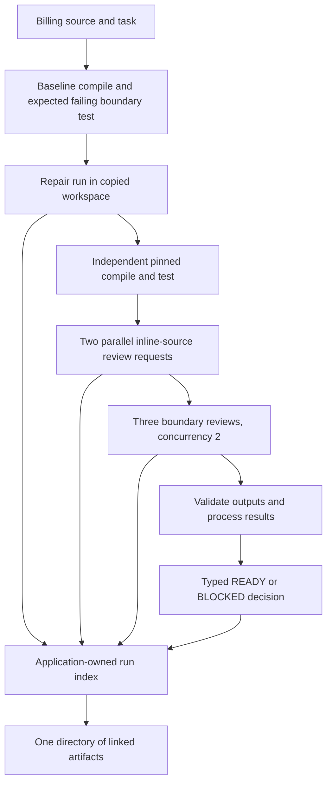
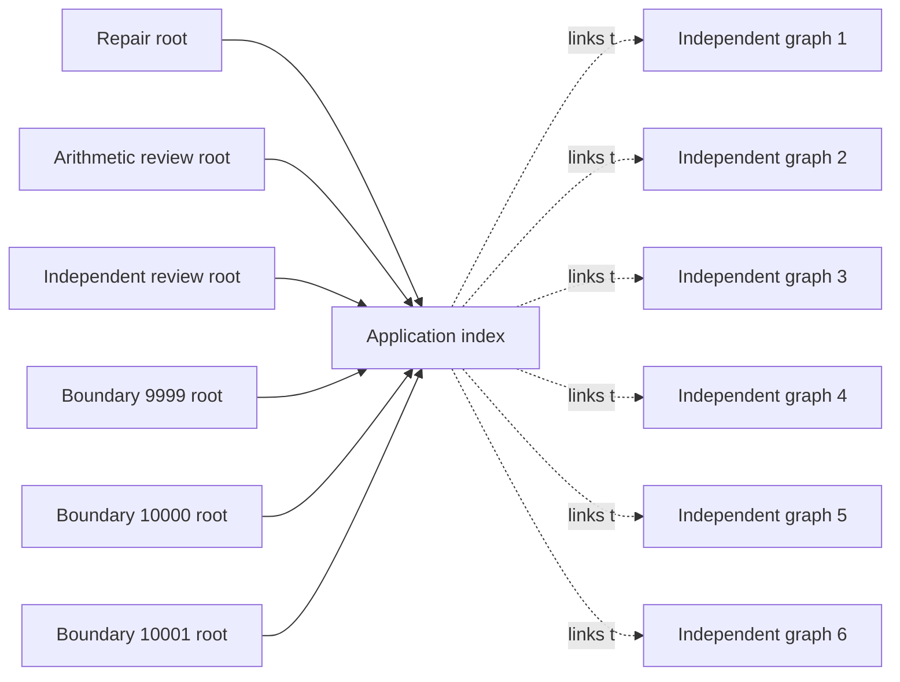

# Run the billing check locally

This walkthrough runs a small Scala CI-style workflow against a copied fixture. The fixture has a planted boundary bug: a discount should apply when the subtotal is **at least** 10,000 cents, but the original code uses a strict greater-than comparison. The workflow asks an agent to repair it, verifies the result with independent compiler and test processes, collects two source reviews and three boundary reviews, then writes a typed `READY` or `BLOCKED` decision.

The runnable application is [`BillingCi.scala`](../examples/user-guide/ci/BillingCi.scala); [`user-ci.sh`](../scripts/build/user-ci.sh) builds it against the current checkout. This is an explicitly opted-in live example: it needs a configured OpenAI-compatible endpoint and may incur provider cost. No credentials belong in the command or files.

## Prepare and run

Prerequisites: JDK 21, `sbt`, `jq`, and a private Raider provider configuration. The script checks the JDK version and writes build outputs under `artifacts/user-ci/`.

```sh
sh scripts/build/user-ci.sh
```

Before launch, configure these variables through the approved private environment or credential helper: `RAIDER_PROVIDER=openai`, `RAIDER_BASE_URL`, `RAIDER_MODEL=glm-5.3-flash`, and either `RAIDER_API_KEY` or `RAIDER_API_KEY_CMD`. Set `RAIDER_LIVE_APPROVED=1` only when you intend to make the live calls. Then run:

```sh
RAIDER_LIVE_APPROVED=1 java -cp "$(cat artifacts/user-ci/classpath.txt)" demo.BillingCi \
  "$(cat artifacts/user-ci/runtime-classpath.txt)" \
  artifacts/user-ci/run \
  examples/user-guide/fixture
```

The three arguments are the child-run runtime classpath, the output directory, and the source fixture. The application copies the fixture to `artifacts/user-ci/run/workspace` before it changes anything. Its five-minute pipeline deadline bounds the whole example; each native agent invocation has a 120-second deadline and its own default `maxAttempts=400`. Those per-run limits do not add up to a shared request or cost cap.

The expected successful result is application decision `READY`, process exit 0, and `SUCCEEDED` in `pipeline-index.json`. `READY` means the baseline compiled and failed only at the exact threshold, the repair changed the source, the independent final compile/test passed, both general reviews passed validation, and all three boundary results passed. `BLOCKED` or another ordinary failure exits 1; a pipeline deadline writes an `UNKNOWN` index state and exits 24. These are application outcomes, not promises about a provider call.

For a concrete recorded example, the successful capture below has decision `READY` and process exit 0. It is historical evidence for the exact captured source/configuration, not a fresh run of your checkout. The unified lineage corpus discussed later is a separate offline acceptance artifact; it does not claim to be the lineage output of this live six-invocation application.

## Find the results

Start at `artifacts/user-ci/run/decision.json` for the typed application decision and `pipeline-index.json` for stage statuses and links. Each agent stage's `nativeWorkDir` points to its own run directory. That directory can contain `run.json` (native status and exit), `events.jsonl` (the run's event stream), `summary.md`, `transcript.json`, and, for a settled reducible run, `lineage.scala` plus `lineage-data.json`. The baseline and final compiler/test process outputs are `baseline-check.log` and `final-independent-check.log`; they are not extra native agent roots. The copied and potentially repaired source is under `workspace/`.

Use the index to locate a stage instead of guessing runtime-assigned run IDs:

```sh
RAIDER_PIPELINE=artifacts/user-ci/run
jq '.status, .decision, .stages[] | .' "$RAIDER_PIPELINE/pipeline-index.json"
RAIDER_STAGE=$(jq -r '.stages[] | select(.name == "repair") | .nativeWorkDir' \
  "$RAIDER_PIPELINE/pipeline-index.json")
jq '.nodes, .data' "$RAIDER_PIPELINE/$RAIDER_STAGE/lineage-data.json"
cat "$RAIDER_PIPELINE/$RAIDER_STAGE/lineage.scala"
```

The index is an application-owned list of six independent native roots. Its links are useful for finding evidence, but they do not join the roots, provide a shared budget, or make the workflow resumable.

The [complete historical native projections](examples/ci-pipeline/native-projections.md) show the actual six graphs from the recorded run and explain their provenance. The [lineage walkthrough](user-guide-lineage.md) explains node links and artifact limits.

## What the workflow does

The order is deliberate: establish the expected baseline failure; repair; independently compile and test; run two reviews in parallel; check three discount boundaries with concurrency two; validate the structured answers; then write the decision and artifact index. Review stages receive source inline and are checked for tool calls and workspace changes. Those checks detect unwanted behavior after execution; they do not restrict the agent's registered tools or sandbox its process permissions.

## What the application does

The application works on a copy of the checked-in billing fixture. Compiler and test results come from actual process exits, not from model summaries.



The graph describes orchestration and file ownership in the example. It does not claim that this application's own runs share a native graph: each of its headless invocations is an independent native root. What Raider's lineage layer assembles when the same stages run as delegate children of ONE run — the unified phase graph with real delegation edges — is documented below in [Unified lineage for this pipeline shape](#unified-lineage-for-this-pipeline-shape), with the actual generated artifacts from the RAI-146 acceptance corpus. The application index links separate headless run directories; it is an application-owned document, not native lineage or a shared accounting ledger.

The two reviewer prompts request analysis of the inline source and forbid tools. The application rejects a reviewer result if it observes a tool call or any file in that review's workspace. The current `coder` agent still has the full registered tool set and process permissions; these prompt and postcondition checks do not enforce a read-only capability boundary or sandbox arbitrary process effects.

## How the Scala application is wired

The preparation and launch commands are at the top of this guide. The build writes an application classpath and a child-runtime classpath. At launch, `BillingCi` calls [`CliArgs.parse`](../modules/cli/src/main/scala/raider/cli/run/CliArgs.scala) and [`HeadlessRunner.run`](../modules/cli/src/main/scala/raider/cli/run/HeadlessRunner.scala) with generic CI context. The current CLI parser has no `--ci` flag, so the app writes a [`CiContext`](../modules/cli/src/main/scala/raider/cli/run/CiContext.scala) JSON file per invocation with `ci="generic"` and `trusted=false`. The runner redacts the context's repository, ref, SHA, pipeline, and job fields in its artifact view.

The app copies the fixture, writes `RUNBOOK.md` and a pinned checker into that copy, and records each process log. The baseline checker must compile and fail only with `FAIL exact-threshold`; after repair, it must exit zero and report all three boundaries passing. The checked-in original fixture remains unchanged for comparison.

## The Scala composition

[`Program[I, O]`](../modules/core/src/main/scala/raider/core/program.scala) describes a workflow from input type `I` to output type `O`. Calling `apply` constructs a lazy [`Task[O]`](../modules/core/src/main/scala/raider/core/task.scala); it does not start the workflow. `andThen` connects two compatible program types, and `mapOutput` transforms a result. `Task` wraps a ZIO effect and runs only at the interpreter boundary.

The project also provides parallel composition over the same `Task` interpreter in [`Composition.scala`](../modules/dsl/src/main/scala/raider/dsl/composition/Composition.scala). `all(first, second)` returns a tuple when both tasks succeed and fails fast if one fails. `batch.collect(inputs, parallelism)(run)` keeps input order, bounds concurrent work, and returns domain failures as typed `BatchOutcome.Failed` values. It propagates external interruption and defects instead of hiding them.

The billing application connects the repair run to a typed verifier, then composes review and boundary runs. This excerpt is taken from [`BillingCi.scala`](../examples/user-guide/ci/BillingCi.scala); local names and omitted setup are defined in that file:

```scala
repairProgram = agentProgram("billing-repair")
verifyProgram = Program.fromFunction[AgentOutput, VerifiedRepair]("verify-repair") { attempt =>
  Task(ZIO.attemptBlocking {
    val evidence = validateRepair(setup, attempt)
    VerifiedRepair(evidence.sourceChanged, readUtf8(setup.source), attempt)
  }.mapError(error => RaiderError.OutputValidation(
    Option(error.getMessage).getOrElse("repair verification failed")
  )))
}
repairAndVerify = repairProgram.andThen(verifyProgram)
repaired <- Task.zio(repairAndVerify(repairInput))

reviews <- Task.zio(all(
  reviewProgram(reviewsInput._1),
  reviewProgram(reviewsInput._2)
))

boundaryOutcomes <- Task.zio(batch.collect(boundaryInputs, parallelism = 2) { input =>
  boundaryProgram(input)
})
```

The verifier turns the native repair attempt into `VerifiedRepair` only after checking the actual native exit, recorded tool calls, workspace inventory, source change, inclusive threshold, and pinned checker hash. The two review programs run concurrently and return a tuple. `batch.collect` runs the three boundary inputs with concurrency two and preserves their input order. The source then checks the structured JSON fields and combines only validated results into its typed `Decision`.

The application serializes its decision with this source-defined type:

```scala
final case class Decision(
    verdict: String,
    repairCheckExit: Int,
    sourceChanged: Boolean,
    reviewPasses: Int,
    boundaryPasses: Int,
    requiredBoundaryCases: List[Int],
    detail: String
) derives JsonCodec
```

The index uses a separate `StageRef` for each stage. It records a status, the native work directory and root ID when a headless call occurred, the native exit code, a lineage summary and artifact paths, a stage verdict, and the answer file. `Decision` describes the application-level result; the native run records continue to describe each individual invocation.

The baseline checker must exit 1 with exactly `FAIL exact-threshold`; this establishes the planted defect after successful compilation. The repair prompt asks for the smallest change to `Discount.scala` and tells the agent to follow the generated runbook. A postcondition checks that the source changed to use the inclusive `s >= 10000` threshold, no files were added or removed, other fixture files remain byte-identical, the pinned checker hash is unchanged, and the native repair run has a parsed transcript and tool calls. The independent final checker then must exit 0 and include `DiscountSpec: PASS 3 boundaries`.

The requirements and arithmetic reviews receive the current source inline with a request for JSON containing `verdict` and `reason`; their result is accepted only if it parses, says `PASS`, includes a non-empty reason, the workspace remains empty, and the transcript has no tool calls. The boundary reviews process 9999, 10000, and 10001 cents in input order. Each must return valid JSON containing the subtotal, policy-derived expected discount, source-derived observed discount, `PASS`, and a non-empty reason. If either general review fails or fewer than three boundary outputs pass validation, the typed decision is `BLOCKED`.

## Independent results and exit codes

Read process results directly. A `proc_run` tool invocation can return successfully while the command it launched exits nonzero; the application must inspect the recorded process exit code and output. The repair agent's own text is not proof that compilation or tests passed.

The typed decision and process exit are separate values:

| Outcome | Application exit | Meaning |
| --- | ---: | --- |
| `READY` | 0 | All required evidence was present and accepted. |
| `BLOCKED`, invalid arguments, invalid live configuration, or another failed run | 1 | The workflow did not reach its accepted decision. |
| Pipeline deadline exceeded | 24 | The index is marked `UNKNOWN`; a stage outcome may be incomplete. |

These are the application's declared exits. The native `RunResult` for an individual headless invocation has its own `status`, `exitCode`, `checks`, and `output` fields. The runner's `taskVerdict` is `None`; an agent's text is not a verifier verdict. The runner's `checks` array includes a `bundle-preflight` check whose outcome is currently marked `Failed` even when its detail is `preflight ok`. The application bases its decision on the actual headless exit, independent compiler and test results, and its own checked structured review data rather than that check entry.

## Native runs and the application index

Each headless run writes its own `work-<id>` directory. Depending on the reached execution stage, it can contain `run.json`, `events.jsonl`, `summary.md`, `transcript.json`, and lineage artifacts `lineage.scala` and `lineage-data.json`. The run summary records the native root's status, exit code, number of event envelopes, and lineage hash/node count when the event stream reduces successfully.

This application launches six independent headless roots: one repair, two parallel reviews, and three boundary reviews. The baseline and final pinned compile/test commands run as local processes; they are recorded in their own logs rather than as additional native roots. Each native invocation has its own default `maxAttempts=400` and a 120-second deadline; the whole pipeline has a five-minute deadline. The application index explicitly records that there is no shared pipeline budget. The six agent invocations can each include multiple model rounds; there is no aggregate request or USD cap. Stage records link each native root ID, work directory, exit code, lineage summary, and lineage files. The application index does not merge the native graphs into a native phase tree or claim shared root accounting or durable recovery.



The index is `pipeline-index.json`; the typed release result is also written to `decision.json`. Use the emitted index to find each native run; do not guess run IDs. Each run's `events.jsonl` is the checkpoint for its own native graph. The index `budgetNote` records the independent per-run attempt limit and the lack of a shared pipeline budget.

## Unified lineage for this pipeline shape

Raider's lineage layer can render this exact pipeline shape — repair, checks,
reviews, boundary batch — as ONE unified graph with real delegation edges.
This section separates what the shipped product does today from what the
acceptance corpus demonstrates.

### What the shipped product does today

Within a single headless run, delegate children join the run's one
`events.jsonl` (`MultiJobExport`, card RAI-144, ADR-032): child segments are
exported as `schemaVersion: 2` envelopes carrying an `invocationId`
correlation key, the introduction is represented once as a canonical frozen
`Delegated` fork record in the parent's stream, and exactly one
`run_provenance` record (`parentRunId` plus per-child `work_dir`/`events`
artifact pointers) is appended before the campaign's `Terminal`. The versioned
reducer (`reduceWire`/`reducePartialWire`) builds one graph from that stream.
A run with no delegation keeps the byte-identical frozen v1 layout.

This application does not use that path: it launches six independent headless
invocations, so each stage remains its own native root with its own stream,
graph, and budget. The index links the roots; it creates no native edges. The
headless product path does not yet wire delegation into the `coder` agent,
although the runner join is wired and exercised by fixtures. Headless coder
wiring, per-level fork anchoring, and the unified lineage-data writer remain
pending RAI-154. The runtime cannot emit v2 phase envelopes yet; real phase
emission remains pending RAI-153.

### The unified shape the corpus demonstrates

The frozen acceptance corpus at
[`contracts/lineage/unified/`](../contracts/lineage/unified/README.md)
(card RAI-146; the protected acceptance surface of unified lineage) contains
this pipeline shape as ONE multi-job stream: five wire-native phases
(`baseline-check` / `repair` / `final-check` / `reviews` / `boundary`), eight
correlation-linked child segments, one mutating `bash` tool call in the repair
child, two recorded fan-out groups (reviews pair at parallelism 2, boundary
trio at parallelism 3), and a cross-run provenance record — 48 envelopes
total. A phase marker, a correlated child envelope, and the provenance record
from the frozen stream
([`cases/case-1-billing.jsonl`](../contracts/lineage/unified/cases/case-1-billing.jsonl)):

```json
{"schemaVersion":2,"seq":4,"jobId":"camp-billing","rootId":"root-unified-corpus","sessionId":"sess-unified-corpus","atMs":35,"payload":{"type":"phase_started","name":"repair","recovery":"Mutating"}}
{"schemaVersion":2,"seq":1,"jobId":"j-repair","rootId":"root-unified-corpus","sessionId":"sess-unified-corpus","atMs":45,"payload":{"type":"ModelCallStarted","round":1,"model":"repair-model"},"invocationId":"inv-repair"}
{"schemaVersion":2,"seq":19,"jobId":"camp-billing","rootId":"root-unified-corpus","sessionId":"sess-unified-corpus","atMs":235,"payload":{"type":"run_provenance","parentRunId":"run-upstream-2026-10-12-a","artifacts":[{"kind":"work_dir","path":"runs/upstream-a/jobs/j-baseline"},{"kind":"events","path":"runs/upstream-a/jobs/j-baseline/events.jsonl"}]}}
```

(The last line is abbreviated; the frozen record carries sixteen
`work_dir`/`events` pointer pairs, one per joined segment.)

The versioned reader/reducer reduce that joined stream — eight linked child
segments — into one graph whose
SHA-256 is pinned in the corpus expectations
([`cases/case-1-billing.expected.json`](../contracts/lineage/unified/cases/case-1-billing.expected.json)):
`8febe295b01e5bc7da743dfd170c601d42e6a27bba1896a9eedb101d274c3d5b`. The pinned
executed report tree is 23 reports: five phase nodes at nesting 1, eight
delegation nodes and nine child-segment nodes at nesting 2. Its first entries:

```json
{ "id": "camp-billing:n1", "kind": "phase:baseline-check", "dataRef": null, "inputs": [], "nesting": 1 },
{ "id": "camp-billing:n2", "kind": "delegation:ci-baseline", "dataRef": null, "inputs": ["camp-billing:n1"], "nesting": 2 },
{ "id": "j-baseline:n1", "kind": "model:check-model:1", "dataRef": "j-baseline/round-1", "inputs": ["camp-billing:n2"], "nesting": 2 },
{ "id": "j-repair:n3", "kind": "tool:bash:Mutating", "dataRef": "j-repair/call-c1", "inputs": ["j-repair:n1"], "nesting": 2 }
```

The rendered program for that graph is checked in, real, and byte-pinned. It is
the **complete current unified DSL projection** generated for the RAI-147
guide acceptance; open the linked Scala file for every phase and delegation
definition, including sections not excerpted here:
[`examples/ci-pipeline/unified-lineage/lineage.scala`](examples/ci-pipeline/unified-lineage/lineage.scala)
(SHA-256 `77339a8b649e4d7731db79536dcde6de70331f2f1668b41c7dfc0fc0801120cc`,
equal to the corpus `generatedSourceSha256` pin that the verifier
[`UnifiedCorpusVerifierSpec`](../modules/cli/src/test/scala/raider/cli/lineage/UnifiedCorpusVerifierSpec.scala)
re-derives from the frozen stream on every run). In plain terms, each
`phase_*` definition marks a top-level stage. A `delegation_*` definition
represents a child segment linked by its invocation ID; its model and tool
reports follow in recorded order. The `batch(...)` calls appear only for the
recorded parallel review pair and boundary trio. `runProvenance` holds
pointers to earlier run artifacts, while `segments` lists linked child IDs
and invocation IDs. These definitions describe the recorded graph; they do
not launch agents or repeat tools. Representative definitions from the
complete artifact:

```scala
val phase_reviews: Program[Unit, Vector[StepReport]] =
  Program.fromFunction("phase_reviews") { _ =>
    LineageStep.phase("camp-billing:n10", "reviews", None, Vector.empty, nesting = 1)
      .flatMap { n_camp_billing_n10 =>
        batch(List(delegation_ci_review, delegation_ci_review_2), 2)(p => p(()))
          .map { n_camp_billing_n11_batch =>
            n_camp_billing_n10 ++ n_camp_billing_n11_batch.flatten
          }
      }
  }

val delegation_ci_repair: Program[Unit, Vector[StepReport]] =
  Program.fromFunction("delegation_ci_repair") { _ =>
    LineageStep.delegation("camp-billing:n5", "ci-repair", None, Vector("camp-billing:n4"), nesting = 2)
      .flatMap { n_camp_billing_n5 =>
        LineageStep.model("j-repair:n1", "repair-model", 1, Some("j-repair/round-1"), Vector(n_camp_billing_n5.head.id), nesting = 2) // data: j-repair/round-1
          .flatMap { n_j_repair_n1 =>
            LineageStep.tool("j-repair:n3", "bash", "Mutating", Some("j-repair/call-c1"), Vector(n_j_repair_n1.head.id), nesting = 2) // data: j-repair/call-c1
              .flatMap { n_j_repair_n3 =>
                LineageStep.model("j-repair:n5", "repair-model", 2, Some("j-repair/round-2"), Vector(n_j_repair_n3.head.id), nesting = 2) // data: j-repair/round-2
                  .map { n_j_repair_n5 =>
                    n_camp_billing_n5 ++ n_j_repair_n1 ++ n_j_repair_n3 ++ n_j_repair_n5
                  }
              }
          }
      }
  }

val phase_boundary: Program[Unit, Vector[StepReport]] =
  Program.fromFunction("phase_boundary") { _ =>
    LineageStep.phase("camp-billing:n14", "boundary", None, Vector.empty, nesting = 1)
      .flatMap { n_camp_billing_n14 =>
        batch(List(delegation_ci_boundary, delegation_ci_boundary_2, delegation_ci_boundary_3), 3)(p => p(()))
          .map { n_camp_billing_n15_batch =>
            n_camp_billing_n14 ++ n_camp_billing_n15_batch.flatten
          }
      }
  }
```

The five phase defs chain in pre-order in the generated `program` value, and
the artifact also carries the recorded data as values:

```scala
val runProvenance: Vector[(String, String)] =
  Vector(("work_dir", "runs/upstream-a/jobs/j-baseline"), ("events", "runs/upstream-a/jobs/j-baseline/events.jsonl"), /* … 16 pointers total */)
val segments: Vector[(String, String, String)] =
  Vector(("j-baseline", "inv-baseline", "linked"), ("j-repair", "inv-repair", "linked"), /* … 8 linked segments */)
```

### The executed projection is a dry-run description

Executing the generated program (via `Task.zio` on its `Program` — the only
observation boundary) evaluates pure `LineageStep` constructors and returns
`StepReport` values: order equals declaration order equals graph child order,
inputs are threaded as values, and nothing is dispatched — no model call, no
tool call, no I/O (ADR-031). A recorded-failed node short-circuits the chain
with a typed `RaiderError.OutputValidation` whose cause is the structured
`LineageStepFailure`. The generated file is NOT a rerun or replay entrypoint;
its header says so. Replay (`raider replay`) reads the frozen v1 format and
refuses a mixed v1/v2 stream with a typed error, so the unified export is not
a replay input on the current product command surface.

The unified graph shape is distinct from the composition you write with the
shipped DSL verbs — `andThen`, `all`, and `batch` plus `Task` sequencing, as
used by this example. The projection emits `batch(...)` lines only where the
corpus stream records a real fan-out group; it invents no `pipeline` or
`parallel` composition, and neither exists in the shipped API.

### Exit codes and claims are unchanged

This section documents lineage artifacts; it adds no commands, flags, or exit
codes. The application exits and native `RunResult` semantics described above
are unchanged. A unified lineage export or its projection is never a reason a
pipeline succeeds: the decision still comes from actual process exits and the
application's own checks.

### Current limits and follow-ups

- **Different evidence scopes.** The successful six-root capture is an actual
  recorded live run through the Yabanin coding-plan gateway. Unified lineage
  evidence is an offline corpus and projection, not a live unified run. The
  projection dispatches no provider calls.
- **Phase stand-ins.** The product runtime cannot emit v2 phase envelopes yet
  (the frozen ADR-024 hub seam has no phase surface). In the RAI-145
  machinery fixture the campaign phases are inserted at deterministic
  positions around real machinery envelopes; in the RAI-146 corpus the phases
  are frozen wire payloads authored through the real codecs. Real phase
  emission remains pending RAI-153.
- **Per-level anchoring before nested delegation ships.** Fork records are
  root-anchored in the export; nested delegation chains (worker → subworker)
  need per-level anchoring as a precondition. The corpus's
  `case-2-delegation-tree` pins the projection semantics for deeper nesting;
  the export-side anchoring is not shipped; it is part of the RAI-154 follow-up.
- **No unified lineage-data writer yet.** The run artifact writer
  (`RunLineageArtifacts`) refuses phase-bearing graphs typed, so a unified
  program like the one quoted above is produced through the
  projection/verifier path — not yet written beside a run's `events.jsonl`.
  For a real delegation join without phases, the writer emits
  `lineage-data.json` schemaVersion 2 with the top-level `provenance` record
  (RAI-144). Headless coder delegation wiring and the unified writer remain
  pending RAI-154.

## Captured CI run and lineage

Everything in this section is the six-root shape: each native graph below is
one run's single-root lineage, exactly what this application produces today.
For the unified shape, see the previous section.

The [successful captured pipeline](examples/ci-pipeline/successful-run.json)
ran through the Yabanin coding-plan gateway with requested model
`glm-5.3-flash`. It completed in 70.87 seconds with process exit 0 and pipeline
status `SUCCEEDED`. The Scala repair changed the threshold comparison; the
independent compiler and all three boundary assertions passed. Both general
reviews and all three boundary reviews passed their typed result checks.

```json
{"verdict":"READY","repairCheckExit":0,"sourceChanged":true,"reviewPasses":2,"boundaryPasses":3,"requiredBoundaryCases":[9999,10000,10001],"detail":"Independent compile and all three expected-discount reviews passed."}
```

The application that ran has SHA-256
`4d604012ef6c816e8d8eacc76fae351f4f8eecf23d5612e8ff69ab01c35d40ff`.
The capture records its source revision, decision, stage index, and all six
native graphs. All six native invocations exited 0. Repair has 19 nodes:
nine model rounds and ten tool calls. Each of the five inline reviews has
one model node, for 24 nodes across the pipeline. The six agent invocations contain multiple model calls; accounting remains
independent for each native root.

The repair graph records reads and searches, a process call, a patch, a second
process call, and the final model round. This shortened excerpt uses the actual
rounds and data references from its generated `lineage.scala`:

```scala
// model("glm-5.3-flash", round = 6) // data: j_1/round-6
  // tool("proc_run", recovery = "ReadOnly") // data: j_1/call-call_-7179480113816265903
// model("glm-5.3-flash", round = 7) // data: j_1/round-7
  // tool("fs_patch", recovery = "ReadOnly") // data: j_1/call-call_-7179486264209438884
// model("glm-5.3-flash", round = 8) // data: j_1/round-8
  // tool("proc_run", recovery = "ReadOnly") // data: j_1/call-call_-7184280547223400121
// model("glm-5.3-flash", round = 9) // data: j_1/round-9
```

The current native exporter labels even this `fs_patch` node `ReadOnly`.
That is the recorded recovery annotation, not evidence that patching is
read-only or safe to replay. The source did change. Use the tool identity and
original execution evidence to understand the effect; this sanitized capture
is not replay input.

### Earlier blocked attempt

The [first captured attempt](examples/ci-pipeline/first-blocked-run.json)
repaired the bug and passed the independent checks, but its original decoder
rejected fenced JSON replies. Its decision was `BLOCKED`, with one accepted
general review and one accepted boundary review. The first application also
hung after settling its decision and was stopped by the coordinator with
SIGKILL (actual subprocess exit -9). That failed capture remains unchanged.

The successful revision moves process exit after the managed ZIO effect,
isolates each parallel context file, and preserves native artifact references
when a semantic check fails. Its parser accepts a single complete JSON code
fence, then applies the full decoder and exact policy checks. Native success
alone does not approve a stage: the application still checks the returned
values and the deterministic tests before accepting `READY`.

### Inspect a stage

The pipeline index points at each native run. Use the actual `nativeWorkDir`
from the index; run IDs are assigned at execution time:

```sh
RAIDER_PIPELINE=artifacts/user-ci/run
RAIDER_STAGE=$(jq -r '.stages[] | select(.name == "repair") | .nativeWorkDir' \
  "$RAIDER_PIPELINE/pipeline-index.json")
jq '.nodes, .data' "$RAIDER_PIPELINE/$RAIDER_STAGE/lineage-data.json"
cat "$RAIDER_PIPELINE/$RAIDER_STAGE/lineage.scala"
```

The corrected application index links independent native roots. The first
captured index had missing failed-stage references and an inconsistent reviewer
name; its original values remain in the capture, while `nativeRuns` contains
the six graphs recovered from their actual directories. `parentId` records
containment inside a native run; `inputs` links a later model round to the tool
result it consumed. The [lineage walkthrough](user-guide-lineage.md) explains
these relationships and the current limits of captured payloads and replay.
