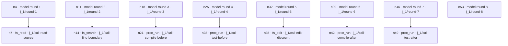

# Read a coding run's lineage

Raider writes a structural record of a completed headless coding run. The record
shows which model rounds and tools occurred, their order, and references to the
associated data. It is useful for inspecting and verifying a run. It is not the
original workflow source, a resumable session, or a transcript of every value
that passed through the tools.

This guide uses the saved offline billing example at
`artifacts/user-examples/verification-ip716woq/coding/work-b1d4212a/`. The local
scripted OpenAI-compatible stand performed the coding sequence; `scripted-billing`
was not a live model. The example reads a Scala discount implementation, searches
for the strict boundary, compiles and tests before the edit, changes `>` to `>=`,
then compiles and tests again. The saved `summary.md` reports a successful run
and exit code 0, and says all three boundary checks pass. Treat the stand's fixed
responses as deterministic fixture behavior, not evidence of model reasoning.

## Find the run artifacts

Each settled run has its own `work-<id>` directory below the `--out` directory.
Lineage files are written beside the event log and normal run results:

```text
<out>/work-<id>/
├── run.json
├── events.jsonl
├── summary.md
├── transcript.json
├── lineage.scala
└── lineage-data.json
```

For this example, the recorded graph hash is
`28cc750c72a2e175c0c9094e8c9fbc4e011a4a16f238abed7f5055d42d1f7b17`, with 15
nodes: eight `model_call` nodes and seven `tool_call` nodes. The sequence below
comes from the saved `lineage-data.json`; `seq` gives the order:

| Model round | Tool child | Purpose |
| --- | --- | --- |
| 1 | `fs_read` | Read the discount source |
| 2 | `fs_search` | Find the strict threshold |
| 3 | `proc_run` | Compile before the edit |
| 4 | `proc_run` | Run tests before the edit |
| 5 | `fs_edit` | Change the discount boundary |
| 6 | `proc_run` | Compile after the edit |
| 7 | `proc_run` | Run tests after the edit |
| 8 | — | Final model round, with no tool child |

This tree follows the actual `parentId` links. The model nodes are independent
roots, ordered by `seq`:



The exported `lineage.scala` is a valid Scala projection. Here is its actual
opening:

```scala
// Generated by Raider lineage projection (ADR-027). Do not edit — comparator detects edits.
object lineage_cli_a2323b24:
  // model("scripted-billing", round = 1) // data: j_1/round-1
    // tool("fs_read", recovery = "ReadOnly") // data: j_1/call-read-source
  // model("scripted-billing", round = 2) // data: j_1/round-2
    // tool("fs_search", recovery = "ReadOnly") // data: j_1/call-find-boundary
  // model("scripted-billing", round = 3) // data: j_1/round-3
    // tool("proc_run", recovery = "ReadOnly") // data: j_1/call-compile-before
  // model("scripted-billing", round = 4) // data: j_1/round-4
    // tool("proc_run", recovery = "ReadOnly") // data: j_1/call-test-before
  // model("scripted-billing", round = 5) // data: j_1/round-5
    // tool("fs_edit", recovery = "Mutating") // data: j_1/call-edit-discount
```

After the round 6 and 7 `proc_run` children, the saved projection ends with
this final model round and the object's closing expression:

```scala
  // model("scripted-billing", round = 8) // data: j_1/round-8
  ()
```

The comments identify graph nodes and their data references. They do not call
the model or execute the tools. The recorded graph has eight model-call roots;
each tool call is a child of its corresponding model call. Read those roots in
`seq` order rather than inferring parent edges between model rounds.

## Follow a `dataRef` into the JSON

Each Scala comment's `data:` value is a key in the `data` object of
`lineage-data.json`. For example, the first model node refers to
`j_1/round-1`, and its `fs_read` child refers to `j_1/call-read-source`:

```json
{
  "j_1/round-1": {
    "model": "scripted-billing",
    "round": 1,
    "prompt": "",
    "response": "",
    "usage": {
      "reservedMicroUsd": 0,
      "observedMicroUsd": 0,
      "unknown": true
    }
  },
  "j_1/call-read-source": {
    "tool": "fs_read",
    "callId": "read-source",
    "recovery": "ReadOnly",
    "outcome": "Succeeded",
    "argsSummary": "{\"path\":\"src/main/scala/billing/Discount.scala\"}",
    "resultTail": null
  }
}
```

These are the actual saved values for this fixture. All eight recorded
model-call entries have empty prompt and response strings. All seven tool-call
entries have `resultTail: null`; the `argsSummary` and `outcome` still identify
the recorded operation and status. Do not treat an empty response or null tail
as proof that the model or tool had no input or output. The event log is the
source of truth for the run, while these lineage artifacts are a projection.

Use `jq` to inspect a particular reference and its node:

```sh
jq '.data["j_1/round-1"]' <run-dir>/lineage-data.json
jq '.data["j_1/call-read-source"]' <run-dir>/lineage-data.json
jq '.nodes[] | select(.dataRef == "j_1/call-read-source")' <run-dir>/lineage-data.json
```

The Scala API follows the same exact-key rule. `RecordedSource.fromFile(path)`
loads the data document; `source.modelOutput("j_1/round-1")` returns that
recorded model-call entry. Unknown references and references to non-model data
produce typed errors. It does not search by prefix or invent a replacement
answer. See [RecordedSource.scala](../modules/dsl/src/main/scala/raider/dsl/lineage/replay/RecordedSource.scala)
and the [lineage data contract](lineage.md#1-three-artifacts-and-the-source-of-truth).

## How the Scala DSL relates to lineage

The headless run above used the built-in `coder` agent and native workspace
tools. The Scala REPL exposes a separate DSL for composing asks. For example,
the current billing review fixture creates two lazy asks, labels their results,
and executes them together:

```scala
val scoutAsk = scout("Review the billing boundary and give a counterexample.")
  .map(answer => ("boundary-review", answer))
val testAsk = worker("Propose expected cases below, at, and above $100.")
  .map(answer => ("test-plan", answer))
val (review, plan) = all(scoutAsk, testAsk).run()
```

This illustrates current DSL composition from
[`06billing-review.repl`](../examples/user-guide/repl/06billing-review.repl).
It is a separate REPL example; it is not the source program that produced the
headless `coder` artifact shown above. `lineage.scala` is generated from the
observed graph, not a saved copy of the original Scala workflow. It contains
structural comments and `dataRef`s, not executable model/tool instructions.

## Verify a saved run

The product command replays a recorded run without calling a model provider:

```sh
raider replay <run-dir> --workspace <original-workspace>
```

The command reads `lineage-data.json`, uses the recorded model answers, and
recomputes supported deterministic tools against a throwaway workspace copy.
It compares the resulting graph and reports a match or the first divergence.
The original workspace is checked for changes. A match verifies graph structure
under this replay path; it does not establish that a live model would make the
same choices. See [the replay command contract](lineage.md#10-actual-commands-and-paths-checked-against-modulescli).

The source run's `summary.md` reports `SUCCEEDED` and exit code 0. Its `run.json`
also records a `bundle-preflight` check with outcome `Failed` and detail
`preflight ok`, alongside a passed `run-result-schema` check. Keep that artifact
detail visible when interpreting the saved evidence; the lineage graph itself
does not resolve this check-status inconsistency. No replay was performed while
preparing this guide.

## Trust and limits

- A lineage projection and its referenced data are part of the run evidence.
  Editing the projection changes what the graph comparator sees.
- Scala and process execution use the invoking user's permissions. Workspace
  tool policy does not sandbox arbitrary Scala code.
- Replay uses an isolated copy for supported replay operations; it does not
  merge changes into the original workspace or guarantee exactly-once behavior
  for arbitrary Scala effects.
- This saved example used a scripted local stand and recorded unknown usage.
  Its zero-valued reserved/observed amounts are not evidence of a priced live
  request or general provider billing behavior.
- The lineage records structure and references. Check `events.jsonl`,
  `transcript.json`, `run.json`, and the original verification report for the
  detail needed to answer a specific execution question.

For the schema, artifact lifecycle, replay modes, and implementation status,
see [Session lineage](lineage.md). For the complete billing workflow and its
offline verifier, see [the user guide](user-guide.md).
