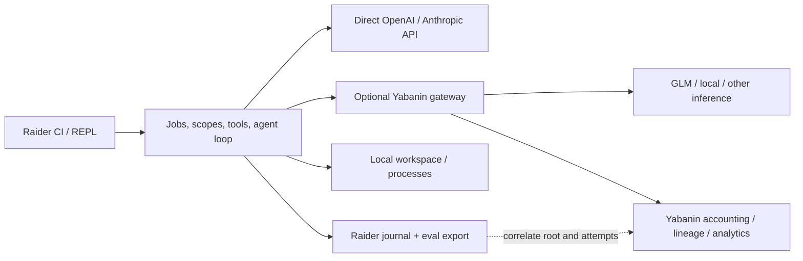

<!-- Translated from Russian original. Key terms preserved as-is. -->

# Raider + Yabanin

Yabanin is an optional integration. The core runtime, CI/REPL, model loop, tools, and local budgets work through direct OpenAI-compatible/Anthropic-compatible profiles: [protocol contract](provider-protocols.md). This document describes additional gateway guarantees, not a required dependency.

## 1. Verified local baseline

The neighboring `tokenrouter` checkout was studied at HEAD `0dbb287ac46be0dbf95d77f87a066baa4c42add3`, dated 2026-10-02. The [snapshot](research/yabanin-snapshot.json) contains hashes for 24 specific files and their working-tree status. The snapshot files were clean. This was read-only research, not an audit of the whole product or a check of a deployed server.

For executing cards, use `YABANIN_REPO=/path/to/checkout`. Do not hard-code the author's machine path in scripts/build.

| Finding | Source in Yabanin | How to use it |
| --- | --- | --- |
| OpenAI-compatible gateway, routing/cache/failover | `README.md`, `docs/architecture.md`, `pkg/cli/gateway.go` | One inference endpoint instead of a separate routing implementation |
| Chat Completions, Responses, Models routes in current code | `pkg/cli/gateway.go`, `pkg/cli/models_endpoint.go`, `pkg/cli/responses_endpoint.go` | Probe a specific deployment; Chat-first adapter |
| CI child environment/session/report | `docs/ci.md`, `pkg/trcli/ci.go` | Wrapper-first integration through `yb ci exec`, without a new control plane |
| Attribution labels | `docs/labels.md`, `pkg/labels/header.go`, `pkg/cli/labels_mw.go` | Root/job/task/model-role attribution |
| Mint/revoke/finish/usage session keys | `pkg/cli/sessionkeys_api.go` | Scoped credential/accounting boundary |
| Decision metadata | `pkg/cli/decision.go`, `pkg/cli/chat.go` | Record requested/actual model and routing evidence |
| Harness connect/disconnect/doctor | `docs/harness.md`, `pkg/harness/adapters/registry.go` | Add a Raider adapter in a separate Yabanin card |
| Persistent delegation controller | `pkg/delegation/controller/*`, `pkg/trcli/delegate.go` | Align formats; do not create two controlling controllers for one job |
| Agent-eval contracts and fixtures | `pkg/agenteval/contracts/*` | Export Raider episodes for independent evaluation |
| Quality runner and protected command registry | `scripts/quality/README.md`, `scripts/quality/commands.json` | Adopt the evidence and gate-classification model |

Important discrepancy: `docs/api/openapi.yaml` describes a limited Chat API, while the current router contains more endpoints. `pkg/trcli/harness.go` also contains an outdated message saying `/v1/models` is unsupported. Therefore, do not generate the entire Raider client from this OpenAPI document without checking the contracts.

In the studied code, `yb delegate` runs FakeExecutor by design and is not a ready live Scala-agent backend. The existing MCP Orchestrator is a separate surface; its presence does not prove parity with Raider's new jobs model.

## 2. Separation of responsibilities



Raider owns agent lifecycle, context, tools, delegation, local budgets, and workflow validation. Yabanin owns provider resolution/routing, its auth principals, key/session policies, gateway costs, and lineage. Raider does not connect directly to Yabanin Postgres/Redis or import its Go packages.

The model role (`fast`, `worker`, `review`, `architect`) expresses Raider's intent. The concrete requested model/alias is a Yabanin connection setting. The actual model is taken from the response/evidence. Do not duplicate cost-aware routing in both places by default.

The benefit of combining them: Yabanin shows which workflows/agents/attempts consume funds; Raider shows why an agent was called and what it did. Both products are useful independently.

## 3. First connection profile

Target Raider configuration; the exact schema is to be approved by RAI-005:

```toml
[providers.yabanin]
kind = "yabanin"
base_url = "http://localhost:8082/v1"
api_key_env = "YABANIN_API_KEY"
session_key_mode = "optional"

[models.fast]
provider = "yabanin"
model = "configured-fast-alias"

[models.worker]
provider = "yabanin"
model = "configured-worker-alias"

[models.review]
provider = "yabanin"
model = "configured-review-alias"
```

The model values are intentionally placeholders. Actual available IDs are read from the deployment/configuration. Do not copy names from an outdated tutorial or promise the availability of a particular GLM.

Credentials: an env reference or structured helper command argv; do not store values in TOML/history. The helper is not invoked through a shell string, has a timeout/output bound, writes only the credential to stdout, and has sanitized stderr. Env is MVP; helper is beta.

Normalize the base URL once: append `/chat/completions` to `/v1`, not another `/v1`. The session-key API is located relative to the origin at `/v1/yabanin/...`; do not accidentally construct `/v1/v1/yabanin/...`.

## 4. Capability doctor

By default, `raider doctor --profile yabanin` does not call a model. It checks URL/TLS/config, health availability, the model registry if permitted, and status endpoint/session-key support without creating a paid task. Raw keys are not printed.

The separate, explicit `--probe-inference` runs a minimal capped smoke only when a live mode/budget is selected. Tool/stream/structured-output capabilities are confirmed by fixtures and such a smoke; they are not inferred from `/models` alone.

The result records server version, checked timestamp, endpoint status, supported/unsupported/unknown, capability-cache TTL, and credentials mode without its value. 401/403 do not mean unsupported; 501 session-keys-unavailable does not mean ordinary inference is broken.

## 5. HTTP and streaming

Yabanin connection MVP: `/v1/chat/completions`, tool calls, SSE, usage. Standalone OpenAI-compatible Chat and Anthropic-compatible Messages are included in M0; [both wires](provider-protocols.md) are normalized independently of the gateway. Responses is a future, separate adapter. Yabanin `/messages` can be connected through the Anthropic wire after deployment-specific conformance; the existence of a route does not mean feature guarantees are ready.

The parser must pass fixtures for:

- UTF-8 code points split across network chunks;
- SSE frames and `data:` lines split into arbitrary chunks;
- multi-line data, comments/keepalive, CRLF, and empty deltas;
- `null` content in a tool-only response;
- multiple tool calls with interleaved indices and partial arguments;
- usage-only chunk, reasoning metadata, finish_reason, and `[DONE]`;
- explicit provider error, invalid JSON, EOF before the final marker, and idle timeout;
- truncated oversized frame and cancellation mid-body;
- gateway denial of tool calls — do not execute calls that are actually absent;
- invalid output schema and bounded repair.

Where possible, reuse the sanitized Yabanin corpus at `pkg/apiformat/testdata`, recording its origin/hash/license. Copy the test fixtures into Raider; do not link to the mutable neighboring working directory.

## 6. Attribution and IDs

Request headers confirmed by the source:

```text
Authorization: Bearer <resolved credential>
X-Session-Id: <conversation UUID>
X-Yabanin-Task: RAI-021
X-Yabanin-Labels: <canonical encoded labels>
```

`X-Session-Id` is a separate conversation/job identity; multiple independent children do not write to the same conversation history concurrently. `raider.root` links them into one task.

Proposed client labels:

```text
harness=raider
raider.root=<root-id>
raider.job=<job-id>
raider.parent=<parent-job-id>
raider.agent=<profile-id>
raider.workflow=<workflow-name>
raider.attempt=<attempt-id>
task=RAI-021
git.repo=yabaninai/raider
git.ref=<branch>
git.sha=<sha>
```

This is a new namespace for client labels, not new auth headers. They are accepted only if org policy permits them. Keys are sorted; values are percent-encoded using Go `url.PathEscape`; pairs are comma-separated. Space, `+`, `/`, `,`, `=`, and Unicode require cross-language golden tests; do not substitute form encoding for PathEscape.

Observed limits: up to 20 labels per source, 32 effective by default, values up to 128 characters, and the `yabanin.` prefix reserved. The client selects a bounded set and displays dropped/missing metadata; on overflow it does not silently fix things by removing `task`.

Locked key/session labels take precedence over request labels. Labels attribute spend; they do not grant permission. Raider does not set `X-Agent-Id`, `X-Team-Id`, or `X-Session-Key-Id` as its own identity source: the gateway derives them from the authenticated principal.

Do not automatically add high-cardinality root/job/attempt labels to hourly rollup dimensions. Start with request logs/export; aggregates by workflow/agent/model role belong to an agreed Yabanin analytics card.

## 7. Session keys

Routes observed:

```text
POST   /v1/yabanin/session-keys
DELETE /v1/yabanin/session-keys/{id}
POST   /v1/yabanin/session-keys/{id}/finish
GET    /v1/yabanin/session-keys/{id}/usage
GET    /v1/yabanin/usage
```

Minting requires a parent `yb_` key with `can_mint_sessions`; a session key cannot mint another key, and an agent principal is not the same as a mint-capable parent. There are TTL/rate limits and deployment DB availability constraints. Check numeric limits against the versioned contract; do not hard-code them perpetually without tests.

Prefer one bounded session key per root workflow, shared by descendants; pin the root TTL/cap/labels. Store the credential reference separately from the journal. The agent profile receives an opaque credential capability, not the parent secret.

Modes:

- `disabled`: ordinary credential; local root limits, without claiming a gateway scoped cap;
- `optional`: unsupported mint capability allows a run using an explicitly configured parent credential, with visible degraded status;
- `required`: mint/reconciliation failure blocks the run; no fallback to the parent key.

Do not carry over the silent fallback behavior of the existing `yb harness key` into Raider strict mode. If a helper returns a parent key, the capability check must detect the difference and must not claim a scoped credential.

On root completion, send a finish status with idempotent semantics according to the API; on explicit revocation, revoke the key. Failure does not turn the agent outcome into success; retain unresolved accounting state. Expiration/revocation does not prove cancellation of a request already dispatched upstream.

## 8. Spend and routing evidence

Record the requested model, actual model if confirmed, provider/backend, local AttemptId, gateway request/decision metadata, usage fields, estimates, observed amounts, and accounting coverage.

Do not treat `X-Yabanin-Decision` as an answer about task correctness. It reflects the gateway routing decision. Do not promise a gateway request ID, pricing snapshot, or nested attempt IDs unless the deployment provides them.

The usage endpoint contains `complete`, `unpriced_requests`, totals/by_model, and optional groups. Reconciliation waits for a bounded interval that accounts for logger lag; incomplete does not become complete just because a timer expired. The final record may be `accounting_pending/partial/complete`, independently of `execution_status`.

Check the session cap in the existing deployment against concurrency/unknown-price/streaming fixtures. The source contains post-hoc sessionbudget logic; the presence of a `max_cost_usd` field does not prove strictly zero overshoot. Raider root admission and gateway admission are two different guarantees; claim them only when supported by measured contracts.

Do not retry budget denial or policy denial forever. Distinguish 429 rate limit from 429 budget exceeded using the structured error; 403 model/whitelist denial is terminal; do not bypass a 503 datastore failure by using a direct provider.

## 9. Cache and side effects

Gateway cache replay must not repeat a filesystem/process mutation merely because the transcript contains the same call again. Each tool invocation has a separate identity and execution ledger; this does not automatically provide exactly-once behavior after a crash.

Before live acceptance, check the cache policy for tool-bearing requests and identity/context keys. Do not invent a request header to disable caching; use only a confirmed gateway setting/API. Fixtures should explicitly cover cache on/off, repeated prompts, different tool schemas, stateful sessions, and parallel children.

## 10. Harness integration

In the MVP, Raider connects to a Yabanin endpoint through a generic OpenAI-compatible URL/key profile. Enriched Yabanin connection/labels/doctor and the wrapper lifecycle contract are implemented by RAI-037/038. The next step is a separate Yabanin card, YB-RAI-01: an adapter in `pkg/harness/adapters`, registry entry, managed config block, and connect/disconnect/drift/doctor tests.

The config transaction must preserve user settings, permissions, backups, and secret references. Connect is idempotent when run twice; disconnect restores the previous config; drift is not silently overwritten. The adapter has its own runtime config schema version.

## 11. Agent-eval

Export a compatible run directory: `manifest.json`, `episodes.jsonl`, `calls.jsonl`, `tools.jsonl`, and `verdicts.jsonl`, following Yabanin's JSON Schema 2020-12.

Keep separate measurements for execution outcome, task outcome, safety outcome, protocol outcome, and usage/cost/coverage. Process exit 0 does not prove task success. Tool arguments in telemetry are represented by a digest, not raw secrets. Tool refusals include `deny_reason`.

The actual verdict is produced by a protected deterministic verifier; the model does not record its own success. For research tasks, rubrics/LLM judge are only a separate calibrated soft signal. Coding tasks check the diff/tests and save the actual workspace hash.

## 12. Integration sequence

1. Both native standalone wires; optional gateway endpoint through a generic Chat profile. For CI users, then use the existing `yb ci exec` wrapper-first contract, without Go changes.
2. Capability doctor and a live free/local stand with a mock upstream.
3. Labels/decision metadata and session-key modes.
4. Capped real-provider smoke after the deterministic free gate.
5. Agent-eval export and model comparison on identical fixtures.
6. `yb harness connect raider` in a separate Yabanin PR.
7. If need is confirmed: Raider as executor for the existing delegation protocol, without two competing owners.
8. If need is confirmed: dashboard links/usage drilldown and cross-process budget authority.

Yabanin modifications must always follow its `AGENTS.md`, applicable Go skills, and `make quality-changed QUALITY_EXECUTE=1`; release/readiness requires `make quality-full` plus integration/acceptance. Passing Raider gates does not replace these checks.

## 13. CI wrapper-first integration

The studied Yabanin already provides `yb ci exec --session=on -- <command>`: child-only URL/credential/labels, preservation of the child's exit code, and `yabanin-ci.json`. This is a quick optional path without Go modifications:

```text
yb ci exec --session=on -- raider run --bundle pipelines.jar \
  --workflow audit --input "Review the project" --ci auto --profile yabanin \
  --policy ci-readonly --out artifacts/raider
```

URL precedence in Raider: explicit CLI override → selected config URL → wrapper env, if the profile declares an env URL source. Resolve credentials only through the configured env reference; absence of a config URL does not automatically call an unknown endpoint. Schema RAI-005 fixes the source and precedence. Parse `YABANIN_LABELS` with the canonical decoder; add bounded request labels while preserving owner/locked CI attribution. Overflow is visible; do not simply overwrite the wrapper environment.

Inherited `YABANIN_API_KEY` may be a `ybs_` key: the wrapper owns mint/finish/poll, and Raider neither requires a mint-capable parent nor creates a second session. In `run.json`, the lifecycle owner is `wrapper`; local budget/accounting coverage is recorded separately. Descendants receive an opaque same-root credential capability. Native own-root mode is RAI-038; if minting is unavailable, `optional` visibly degrades and `required` is blocked.

The Yabanin CI contract describes bounded polling: session `complete`, header, and two identical bodies. Header stability is not proof of completeness. `yb ci report --pipeline --fail-over-cost` is a post-hoc policy with exit 4, not concurrent spend prevention. The GitLab Premium metrics widget is optional; generic Raider artifacts/JUnit/accounting JSON do not require a paid tier.

Account for wrapper cleanup/poll (up to 30s in the studied contract) in the CI timeout, in addition to Raider grace/upload. Verify SIGTERM forwarding/child env/session cleanup through actual wrapper acceptance; do not infer them from CLI syntax. Do not put the key in a dotenv artifact; a fork job does not receive a gateway key.

Raider run/result/checks report task correctness; the Yabanin report describes observed gateway usage. Neither substitutes for the other. Root/pipeline labels connect the evidence without giving Raider access to the internal DB.
